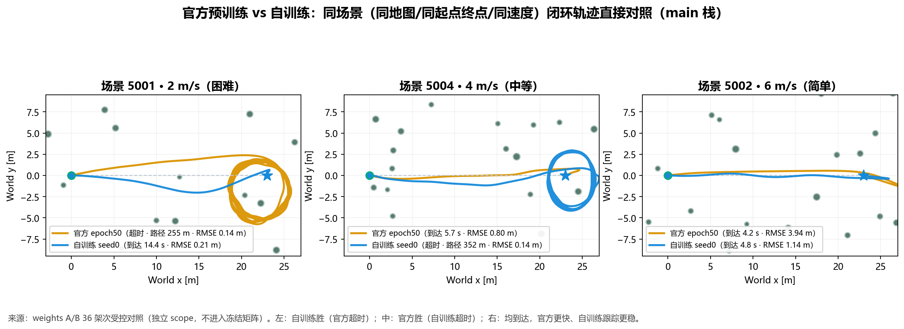
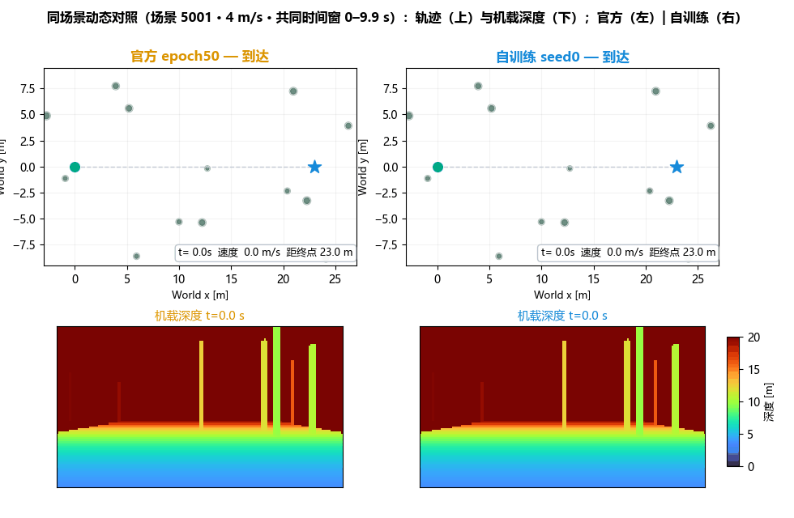
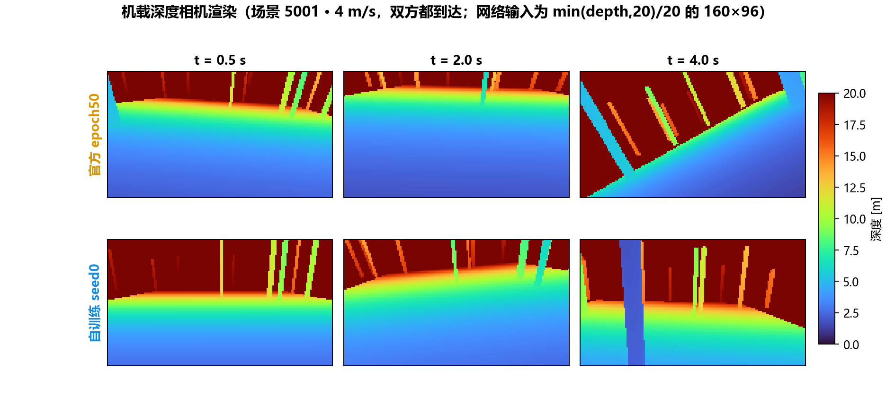
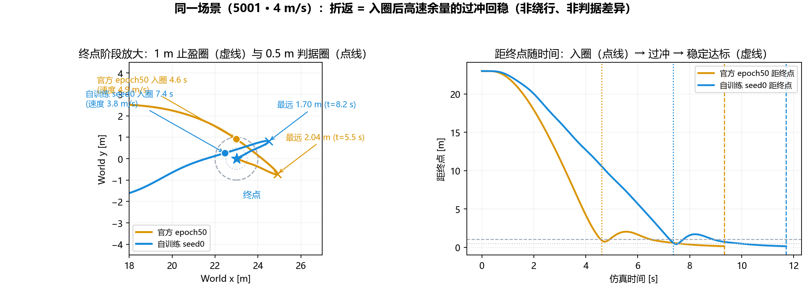
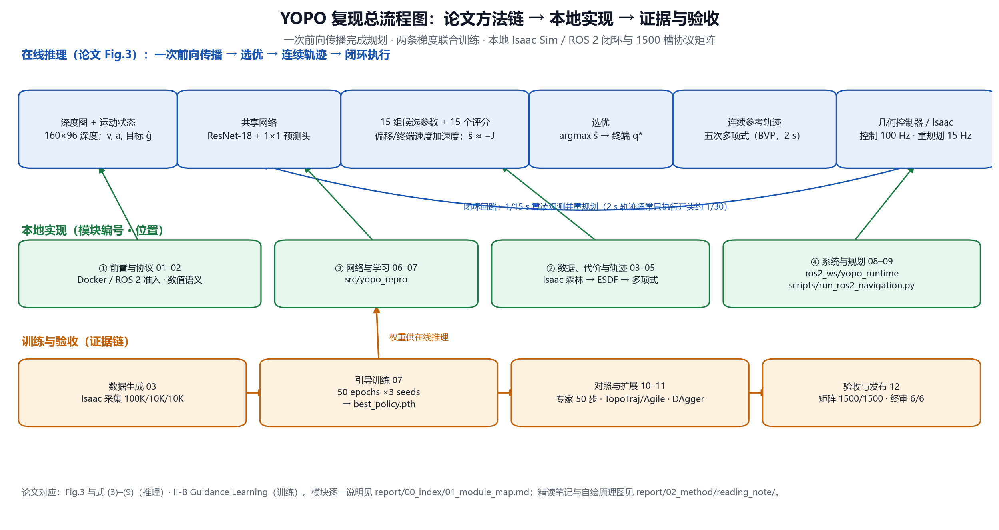

# YOPO 复现工程 · YOPO Reproduction

**「You Only Plan Once: A Learning-Based One-Stage Planner With Guidance Learning」的本地复现** —— 从零训练（Isaac Sim 数据 + Guidance Learning）、ROS 2 / Isaac 闭环、官方与自训练权重同场景对照、1500 槽协议矩阵与可迁移归档。

[论文（IEEE RA-L 2024）](https://doi.org/10.1109/LRA.2024.3399589) ｜ [官方项目主页](https://tju-air-lab.github.io/projects/YOPO/) ｜ [官方代码 TJU-Aerial-Robotics/YOPO](https://github.com/TJU-Aerial-Robotics/YOPO)

   

**状态（2026-10-13）**：YOPO-only 活动范围全部收官——三种子 50 轮训练、ROS 2 运行时准入、DAgger 微调、最终展示、活动矩阵 **1,500/1,500**、终审 **6 verified（all_verified=true）**。参考[17] MPPI 按用户决定移出活动范围并[归档](benchmarks/archive/README.md)，不再计入当前验收；本仓库为可迁移发布版，旧主线已存为 tag `archive/pre-yopo-only-20261013`。

## 图文速览：官方预训练 vs 自训练（同场景直接对照）







「同场景」= 同一地图种子、同起点/终点、同速度；上方三组轨迹均为**双方都到达**的直接对照（官方更快、自训练跟踪更稳），动画与深度帧取自其中一组。官方权重原生属于 Simple 栈，直接对照统一在 **main 栈**内完成；交叉栈对照用于避免把「栈差异」误读为「权重差异」。

**到达判据与「折返」成因**（本对照批次为 legacy 闭环；冻结 1500 槽矩阵的判据为「< 0.5 m 且 < 0.3 m/s 连续 0.5 s」）：

- **判据**：终点误差 < 0.5 m 且速度 < 0.2 m/s 连续 1 s、无碰撞。「入圈」= 首次进入终点 1 m 半径的时刻；「稳定达标」= 持续条件满足、episode 正常结束的时刻。
- **折返的成因（既不是判据差异，也不是绕行）**：`run_navigation.py` 在**首次进入 1 m 半径**时，把参考从「网络规划轨迹」切换为「终点位置保持」，并换成低带宽保持控制器（姿态增益减半；水平位置增益 0.08、速度增益 0.12、积分清零）。该切换只看距离、不看速度——切换瞬间飞机仍有约 4–5 m/s 的水平速度（该场景巡航峰值约 7.5 m/s），低增益回路无法立刻抵消动量，飞机沿切向继续飞并**过冲**，随后被位置保持环缓慢拉回终点。轨迹上看到的折返/绕圈，就是这段**过冲回稳弧线**。
- **定量锚点（场景 5001 · 4 m/s）**：官方 入圈 4.6 s（速度 ≈4.9 m/s）→ 最远 2.04 m（t=5.5 s）→ 稳定达标 9.3 s；自训练 入圈 7.4 s（≈3.8 m/s）→ 最远 1.70 m（t=8.2 s）→ 稳定达标 11.7 s。



**离线对照（10,000 独立测试样本，Table I 口径）**

| 权重来源 | 平均候选代价 ↓ | 最优候选代价 ↓ | 与专家最优一致率 ↑ |
|---|---:|---:|---:|
| 随机初始化 | 0.082267 | 0.039556 | 14.9% |
| 官方 epoch50（预训练） | 0.029614 | 0.021963 | 15.2% |
| **自训练 seed0（本仓库）** | **0.023062** | **0.017855** | **22.6%** |
| 专家 mma50（本地重建，参考） | 0.021451 | 0.018753 | — |

**闭环对照（36 架次受控：3 场景 × 3 速度 × 2 栈 × 2 权重）**

| 组合（栈 + 权重） | 成功 | 超时 | 碰撞 | 入圈中位（1 m） | 稳定达标中位 | 跟踪 RMSE 中位 |
|---|---:|---:|---:|---:|---:|---:|
| Simple + 官方 | 8/9 | 1 | 0 | 6.8 s | **9.3 s** | 0.25 m |
| Simple + 自训练 seed0 | 8/9 | 1 | 0 | 11.8 s | 14.2 s | 0.23 m |
| main + 官方 | 7/9 | 1 | 1 | **4.6 s** | 11.3 s | 1.10 m |
| main + 自训练 seed0 | 7/9 | 1 | 1 | 13.9 s | 16.1 s | **0.51 m** |

读法：成功率上分不出高低——**官方入圈更早、回稳更久（main 栈 4.6→11.3 s），自训练入圈稍晚、回稳更快（13.9→16.1 s）**；按「稳定达标」口径官方仍更快，自训练跟踪更稳（误差约为官方一半），且栈匹配效应大于权重差异。每格仅 1 架次，不做显著性宣称；完整口径、失败模式与限制见[官方权重 vs 自训练权重对照](report/04_evaluation/01_official_vs_selftrained.md)。

## 复现总流程图



上排：论文 Fig.3 在线推理链（深度图 → 共享网络 → 15 组候选参数与评分 → 选优 → 五次多项式 → 几何控制器 / Isaac 闭环）；中排：本仓库的对应模块（01–09）与位置；下排：训练与验收证据链（数据生成 → 引导训练 → 对照与扩展 → 验收发布）。逐模块说明见[复现模块总图](report/00_index/01_module_map.md)，可点选版本见[交互式项目全景（HTML）](report/00_index/03_project_map.html)。

## 阅读笔记（论文精读）

- [**YOPO 阅读笔记：从深度视觉到连续轨迹**](report/02_method/reading_note/README.md)：12 节精读（在线流程、运动原语、评分学习、引导训练、实验数字与待核对项），含自绘原理图与公式对照。
- [汇报幻灯片（Beamer · 50 页）](report/02_method/reading_note/slides/yopo_report.pdf)：围绕“前向推理”与“引导训练”组织，附 TeX 源码。
- 与复现对接：论文方法 ↔ 本地实现[逐项对照](report/02_method/01_paper_to_code.md)；原文 ↔ 源码[差异审计（D1–D11）](report/02_method/03_原论文与源码差异审计.md)。

## 快速开始

```powershell
git clone https://github.com/STARLINGWW/YOPO_reproduction.git
cd YOPO_reproduction
git lfs install && git lfs pull     # 权重、smoke 数据与展示媒体走 Git LFS

# 环境探针（Docker Desktop Linux 容器：Ubuntu 22.04 + ROS 2 Humble + GPU）
docker compose --profile training run --rm train python3 scripts/ros2/verify_environment.py --gpu

# smoke 训练：停止 → 恢复（第一次迁移验证；数据随库发布）
docker compose --profile training run --rm train python3 scripts/train_scratch.py --dataset /workspace/datasets/smoke_v1 --run clean_clone_smoke --seed 0 --epochs 1 --batch-size 16 --stop-after-steps 20
docker compose --profile training run --rm train python3 scripts/train_scratch.py --dataset /workspace/datasets/smoke_v1 --run clean_clone_smoke --seed 0 --epochs 1 --batch-size 16 --resume
```

文档/证据一致性审计、最终展示重跑等命令见[执行手册](report/00_index/02_执行手册.md)。

## 文档与代码导航

| 区 | 入口 | 内容 |
|---|---|---|
| plan | [plan/README.md](plan/README.md) | 章程与重构计划、论文协议、环境、数据训练、基线、验收、GitHub/Ubuntu 迁移、决策与变更日志 |
| implement | [implement/README.md](implement/README.md) | 00–07、99 共 9 份代码地图；[implement/workspace](implement/workspace/README.md) 为代码工作区视图（junction/符号链接） |
| report | [report/README.md](report/README.md) | 编号报告文件夹：状态、方法、训练、评测、可视化（含媒体实体文件）、迁移、历史、产物索引 |

建议阅读顺序：[复现模块总图](report/00_index/01_module_map.md) → [执行手册](report/00_index/02_执行手册.md) → [当前进度简报](report/01_status/01_当前进度简报.md) / [复现状态总览](report/01_status/02_复现状态总览.md) → [官方权重 vs 自训练权重对照](report/04_evaluation/01_official_vs_selftrained.md)。

## 复现结果与验证（活动范围）

- 活动矩阵：五模型（YOPO 三种子 + TopoTraj + Agile）× 300 = **1,500/1,500** 全部有终态证据（[summary.json](artifacts/benchmark_summary/summary.json)，`outcome_coverage_complete`）。
- 终审：**6 verified / 0 documented_gap / 0 pending**（[final_acceptance_audit.json](artifacts/environment/final_acceptance_audit.json)）。
- 权重：三个正式种子 `best_policy.pth` 哈希与各自 `training_audit.json` 一致；DAgger 聚合微调完成（闭环收益仍作为研究限制保留）。
- 干净 clone 验证（2026-10-13）：无本机路径残留、全量文档审计 0 缺失、pytest 87 通过、Docker GPU/ROS 2 探针与 smoke 停止/恢复通过；详见[发布与干净 clone 验证记录](report/06_migration/03_github_release_verification.md)。

## ToDo（后续计划）

当前已在 **Windows（Docker Desktop + Isaac Sim 6.1）** 完成全链路复现（数据生成、三种子训练、ROS 2 闭环、1500 槽矩阵与发布归档）；后续迁移到 **Ubuntu 22.04** 做原生训练与部署：

- [x] Windows 上基于 Isaac Sim 的本地复现（训练 / ROS 2 闭环 / 评测 / 发布）— 已完成
- [ ] Ubuntu 22.04 环境复验：clone + LFS + GPU 探针 + smoke 停止/恢复（步骤见 [MIGRATION_UBUNTU22.md](MIGRATION_UBUNTU22.md)）
- [ ] Ubuntu 22.04 原生训练：重跑训练管线并逐步对齐三种子 50 轮设置
- [ ] Ubuntu 22.04 原生部署：ROS 2 Humble 运行时在 Ubuntu 本机完成闭环（仿真 / 实机）
- [ ] 迁移完成后回填验收记录与[迁移报告](report/06_migration/README.md)，并同步更新本 README

## 与官方主项目的关系

- **上游**：[TJU-Aerial-Robotics/YOPO](https://github.com/TJU-Aerial-Robotics/YOPO)（`main` 与 `YOPO-Simple` 分支）是固定的源码参考（`external/audit_sources`，逐文件哈希记录）；论文、演示视频与硬件资料见[官方项目主页](https://tju-air-lab.github.io/projects/YOPO/)。
- **本仓库新增**：Isaac Sim 等效场景与数据生成、从零 Guidance Learning 训练（三种子 50 轮全链路审计）、ROS 2 Humble 运行时与准入、冻结协议矩阵（1,500 槽）与机械验收、官方/自训练同场景对照与深度可视化、DAgger 聚合微调、面向迁移的发布与归档（LFS、校验清单、外部归档 manifest）。
- **记录在案的差异**（评分符号、候选筛选、场景来源等）见[差异审计](report/02_method/03_原论文与源码差异审计.md)与[方法对照](report/02_method/01_paper_to_code.md)；无法完全复现的部分保持显式声明。

## 可直接查看的成果

- [全局飞行视频](report/05_visualization/media/global_trajectory.mp4) ｜ [全局轨迹图片](report/05_visualization/media/global_overview.png) ｜ [渲染来源清单](report/05_visualization/media/render_manifest.json)
- [官方预训练演示视频](report/05_visualization/media/official_pretrained_flight.mp4)（早期阶段，单独保留）
- [论文图表](report/05_visualization/media/paper_figures)：Fig.7 成功率—速度曲线、Table I/II
- 全部逐架次指标与哈希索引：[report/99_artifact_index](report/99_artifact_index/README.md)

## 迁移（Ubuntu 22.04）

- 工作区视图重建（clone 后可选）：Windows `./implement/workspace/bootstrap_links.ps1`；Ubuntu `bash implement/workspace/bootstrap_links.sh`。
- Ubuntu 接续步骤：[MIGRATION_UBUNTU22.md](MIGRATION_UBUNTU22.md)；本机容器验证记录：[report/06_migration](report/06_migration/README.md)。
- Git/LFS 与大文件规则：[plan/06_github_migration/README.md](plan/06_github_migration/README.md)；发布清单：[plan/06_github_migration/01_release_checklist.md](plan/06_github_migration/01_release_checklist.md)。

## 目录总表

| 目录或文件 | 内容 |
|---|---|
| `plan/` | 计划与管理（编号文件夹，含决策记录与参考文件） |
| `implement/` | 实施区：模块地图 + `workspace/` 代码工作区视图 |
| `report/` | 交付展示区（编号文件夹，含 HTML 与视频/图片/图表实体文件；`02_method/reading_note` 为精读笔记） |
| `src/`、`scripts/`、`configs/` | 算法库、运行入口与配置（真实代码位于项目根以保证运行兼容） |
| `docker/`、`compose.yaml` | Ubuntu 22.04 jammy 容器（训练 / ROS 2 / 基线 / 专家） |
| `ros2_ws/src/` | ROS 2 源码（yopo_runtime、interfaces、topotraj、expert、agile、参考包） |
| `external/` | 固定上游源码（audit_sources：main、YOPO-Simple 等） |
| `benchmarks/` | 冻结协议、活动范围声明与准入记录 |
| `datasets/`、`checkpoints/` | 数据与权重（LFS + 外部归档；完整历史见 report/06_migration） |
| `artifacts/` | 证据与演示（精选小体量入库；重目录仅本地引用） |
| `assets/` | Isaac Sim 载具资产（cf21b USD 链，Git LFS 保存） |
| `tests/` | 主机可运行的 pytest 用例（协议、评测、驱动契约等） |
| `local_only/` | 本地专用辅助内容，**不上传**（vendor 探查依赖、上游过期编译产物）；见其 README |
| 根文件 | `README.md`（本文件）；`AGENTS.md`、`CONTRIBUTING.md`（协作/实施约定）；`LICENSE`；`MIGRATION_UBUNTU22.md`；`compose.yaml`；`pytest.ini`；`.gitignore`/`.gitattributes`/`.dockerignore` |

## 引用（Citation）

若本复现对你有帮助，请优先引用原论文：

```bibtex
@article{YOPO,
  title={You Only Plan Once: A Learning-based One-stage Planner with Guidance Learning},
  author={Lu, Junjie and Zhang, Xuewei and Shen, Hongming and Xu, Liwen and Tian, Bailing},
  journal={IEEE Robotics and Automation Letters},
  year={2024},
  publisher={IEEE}
}
```

引用本复现仓库时，可注明仓库 URL 与对应的发布提交（tag `archive/pre-yopo-only-20261013` 之前的历史版本同样保留可追溯）。

## 相关项目

- 官方：[TJU-Aerial-Robotics/YOPO](https://github.com/TJU-Aerial-Robotics/YOPO)（主项目）· [YOPO-Sim](https://github.com/TJU-Aerial-Robotics/YOPO-Sim)（官方仿真）· [YOPO-Rally](https://github.com/TJU-Aerial-Robotics/YOPO-Rally)（后续工作）
- 社区：[dairycowp/YOPO-ROS2](https://github.com/dairycowp/YOPO-ROS2)（ROS 2 版 YOPO-Simple，可对照参考）
- 参考实现：[Fast-Planner](https://github.com/HKUST-Aerial-Robotics/Fast-Planner)（公共车辆/控制来源）

## 许可与致谢

- 本仓库代码按 [LICENSE](LICENSE)（MIT）提供；上游代码、论文 PDF 与第三方资产版权归各自作者所有（见 `external/audit_sources` 与 `artifacts/paper_sources`）。
- 致谢 TJU-Aerial-Robotics 的 YOPO 作者与相关开源社区（Fast-Planner、TopoTraj、Agile Autonomy 等）。

## 变更与发布

- 变更日志：[plan/99_change_log/CHANGELOG.md](plan/99_change_log/CHANGELOG.md)
- 发布清单：[plan/06_github_migration/01_release_checklist.md](plan/06_github_migration/01_release_checklist.md)
- 发布与干净 clone 验证：[report/06_migration/03_github_release_verification.md](report/06_migration/03_github_release_verification.md)
