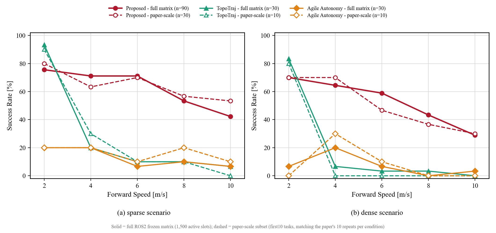
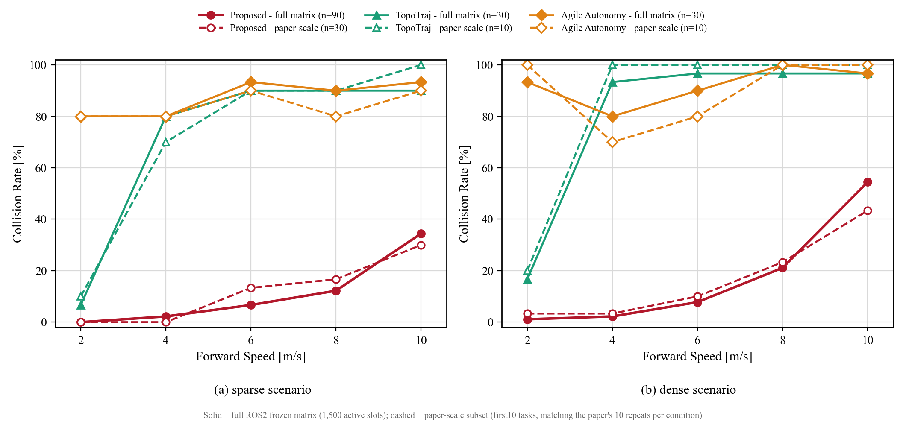
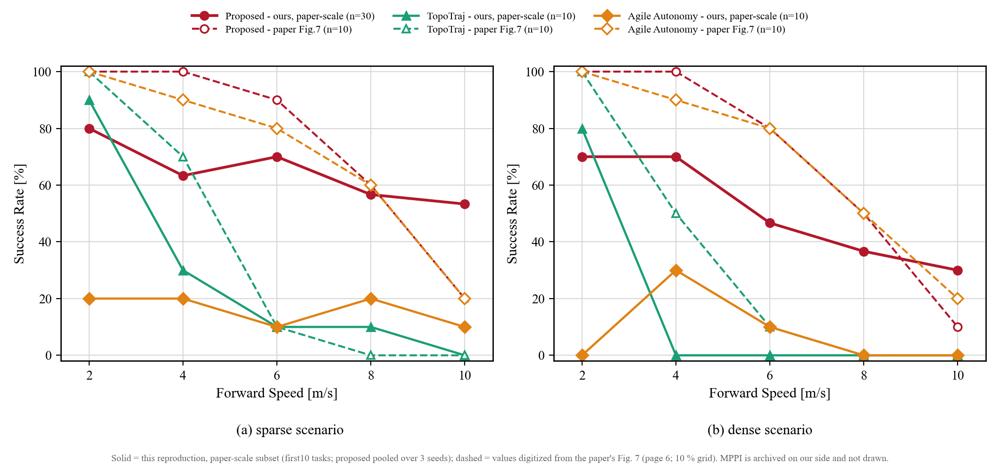

# YOPO 复现项目全景

状态快照 2026-10-14 ｜ 本页是原交互式 HTML 项目全景（`03_project_map.html`）的 Markdown 等价版本（2026-10-14 转换，HTML 版已移除）｜ 权威数据源：[status_overview.json](../../artifacts/environment/status_overview.json)、[summary.json](../../artifacts/benchmark_summary/summary.json)、[final_acceptance_audit.json](../../artifacts/environment/final_acceptance_audit.json)

**一句话**：YOPO-only 活动范围内 12 个模块全部收官——活动矩阵 **1,500/1,500**、终审 **6 verified（all_verified=true）**；参考[17] MPPI 已按用户决定移出活动范围并归档（[benchmarks/archive](../../benchmarks/archive/README.md)、[report/90_archive/mppi](../90_archive/mppi/README.md)）。

## 1. 模块全景（5 阶段 × 12 模块）

| 阶段 | 模块 | 状态 | 关键文件 / 入口 | 关键结果 |
|---|---|---|---|---|
| ① 前置与协议 | 01 论文与源码审计 | 已完成 | [external/audit_sources/main](../../external/audit_sources/main)、[configs/paper_aligned.json](../../configs/paper_aligned.json)、[原论文与源码差异审计](../02_method/03_原论文与源码差异审计.md) | 差异清单锁定正式数值语义：main 正代价评分、训练 `unselect=0`、Isaac 程序化森林替代 Flightmare；无法完全复现处保持显式记录 |
| ① 前置与协议 | 02 运行环境与通信 | 已完成 | [compose.yaml](../../compose.yaml)、[ros2_ws/src/yopo_runtime](../../ros2_ws/src/yopo_runtime)、[runtime_validation.json](../../benchmarks/protocol_v1/runtime_validation.json) | 运行时准入通过（yopo / topotraj / agile 三后端）；最终展示飞行 216 条轨迹全部被接受、213 条应用、0 条过期或覆盖 |
| ② 数据、代价与轨迹 | 03 场景与数据生成 | 已完成 | [scripts/prepare_dataset.py](../../scripts/prepare_dataset.py)、[scripts/collect_isaac_shard.py](../../scripts/collect_isaac_shard.py)、[src/yopo_repro/forest.py](../../src/yopo_repro/forest.py) | 训练 20 张地图 / 100,000 样本；验证 4 / 10,000；测试 4 / 10,000；按地图切分，避免同图泄漏 |
| ② 数据、代价与轨迹 | 04 距离场与轨迹代价 | 已完成 | [src/yopo_repro/main_cost.py](../../src/yopo_repro/main_cost.py)、[src/yopo_repro/maps.py](../../src/yopo_repro/maps.py) | 网络评测与专家重建共用同一套原版目标函数；代价数值与梯度即 Guidance Learning 的训练监督 |
| ② 数据、代价与轨迹 | 05 五次多项式轨迹 | 已完成 | [src/yopo_repro/quintic.py](../../src/yopo_repro/quintic.py) | 训练时 15 个候选各生成一条多项式；推理时只对选中候选生成正式轨迹（差异 D7） |
| ③ 网络与学习 | 06 YOPO 网络与运动原语 | 已完成 | [src/yopo_repro/policy.py](../../src/yopo_repro/policy.py) | ResNet18 + 3×5 原语，一次前向输出 15 个候选（9 轨迹参数 + 1 评分），隐藏 64 维 |
| ③ 网络与学习 | 07 Guidance Learning 训练 | 已完成 | [scripts/train_scratch.py](../../scripts/train_scratch.py)、[checkpoints/formal_main_v1_seed0](../../checkpoints/formal_main_v1_seed0) | 三种子各 50 轮 × 312,500 步、batch 16、Adam 1.5e-4 从头训练，逐轮严格审计通过；seed0 最优验证总损失 ≈ 0.02293 |
| ④ 系统与规划 | 08 在线候选选择与规划 | 已完成 | [main_planner.py](../../ros2_ws/src/yopo_runtime/yopo_runtime/main_planner.py)、[protocol_node.py](../../ros2_ws/src/yopo_runtime/yopo_runtime/protocol_node.py) | 正代价 argmin 选择、只解码所选端点；按消息时间与实测延迟决定应用时刻，过期轨迹在缓冲层丢弃 |
| ④ 系统与规划 | 09 控制器与 Isaac 闭环 | 已完成 | [src/yopo_sim/unified_quad.py](../../src/yopo_sim/unified_quad.py)、[scripts/run_ros2_navigation.py](../../scripts/run_ros2_navigation.py) | 展示飞行成功：航迹 24.641 m、最小净空 1.188 m、终点误差 0.099 m、跟踪 RMSE 0.116 m；物理 500 Hz、控制 100 Hz |
| ⑤ 评估与收尾 | 10 专家与基线对照 | 已完成 | [network_comparison_trained_seed0.json](../../artifacts/expert/network_comparison_trained_seed0.json)、[protocol.json](../../benchmarks/protocol_v1/protocol.json)、[官方权重 vs 自训练权重对照](../04_evaluation/01_official_vs_selftrained.md) | 离线 1 万样本：自训练 seed0 平均/最优代价 0.0231 / 0.0179，优于官方 0.0296 / 0.0220 与随机初始化；MPPI 已归档 |
| ⑤ 评估与收尾 | 11 DAgger 聚合微调 | 已完成（收益待独立验证） | [aggregation_manifest.json](../../datasets/isaac_dagger_v1/aggregation_manifest.json)、[dagger result.json](../../checkpoints/dagger_main_v1_seed0/result.json) | 33 架次采集、11 分片、新增 7,620 样本、10 轮微调完成；闭环收益未独立验证，未进入正式矩阵 |
| ⑤ 评估与收尾 | 12 验收与成果 | 已完成 | [final_acceptance_audit.json](../../artifacts/environment/final_acceptance_audit.json)、[figure_7_success_vs_speed.png](../../artifacts/paper_figures/figure_7_success_vs_speed.png)、[演示程序与权重飞行验证命令](../05_visualization/01_演示程序与权重飞行验证命令.md) | 终审 6 verified、all_verified=true；活动矩阵 1,500/1,500 |

逐模块的详细说明（定位 → 本地实现 → 证据 → 状态）见[复现模块总图](01_module_map.md)；命令入口见[执行手册](02_执行手册.md)。

## 2. 冻结基准执行情况（1,500 / 1,500）

活动范围（`yopo_only_1500`）五个模型 × 300 冻结任务全部有终态证据；失败计入分母，缺失不算成功：

| 模型 | 成功 | 超时 | 碰撞 | 合计 |
|---|---:|---:|---:|---:|
| YOPO seed0（自训练） | 184 | 74 | 42 | 300 |
| YOPO seed1（自训练） | 163 | 87 | 50 | 300 |
| YOPO seed2（自训练） | 174 | 90 | 36 | 300 |
| TopoTraj | 71 | 2 | 227 | 300 |
| Agile Autonomy | 30 | 1 | 269 | 300 |
| **合计** | **622** | **254** | **624** | **1,500** |

超集 1,800 槽中的参考[17] MPPI 300 槽已移出活动范围并归档（不是数据丢失）；权威汇总见 [summary.json](../../artifacts/benchmark_summary/summary.json)（`outcome_coverage_complete`）与[复现状态总览](../01_status/02_复现状态总览.md)。

## 3. 论文 Fig.7 口径：成功率 / 碰撞率 vs 前向速度（ROS2 冻结矩阵）

与论文 Fig.7 相同的形式：两个面板分别对应稀疏（1/30）与稠密（1/20）场景，横轴为 2–10 m/s。**实线 = 完整冻结矩阵**（自训练 YOPO 三种子合并 n=90/点，TopoTraj / Agile n=30/点）；**虚线 = 论文规模子集**（`paper_first10`：与论文同为每条件 10 次试验的口径，提案方法三合并 n=30/点、基线 n=10/点），用于同图观察样本规模带来的差异。论文中的 MPPI 曲线在本仓库已归档，不再绘制。





**稀疏场景（1/30）成功 / 碰撞 / 超时**

| 模型 | 2 m/s | 4 m/s | 6 m/s | 8 m/s | 10 m/s |
|---|---|---|---|---|---|
| YOPO 三种子合并（n=90/点） | 76% / 0% / 24% | 71% / 2% / 27% | 71% / 7% / 22% | 53% / 12% / 34% | 42% / 34% / 23% |
| TopoTraj（n=30/点） | 93% / 7% / 0% | 20% / 80% / 0% | 10% / 90% / 0% | 10% / 90% / 0% | 7% / 90% / 3% |
| Agile Autonomy（n=30/点） | 20% / 80% / 0% | 20% / 80% / 0% | 7% / 93% / 0% | 10% / 90% / 0% | 7% / 93% / 0% |

**稠密场景（1/20）成功 / 碰撞 / 超时**

| 模型 | 2 m/s | 4 m/s | 6 m/s | 8 m/s | 10 m/s |
|---|---|---|---|---|---|
| YOPO 三种子合并（n=90/点） | 70% / 1% / 29% | 64% / 2% / 33% | 59% / 8% / 33% | 43% / 21% / 36% | 29% / 54% / 17% |
| TopoTraj（n=30/点） | 83% / 17% / 0% | 7% / 93% / 0% | 3% / 97% / 0% | 3% / 97% / 0% | 0% / 97% / 3% |
| Agile Autonomy（n=30/点） | 7% / 93% / 0% | 20% / 80% / 0% | 7% / 90% / 3% | 0% / 100% / 0% | 3% / 97% / 0% |

读法（不越界解读）：

- 自训练 YOPO 的成功率随速度单调下降、碰撞率单调上升，符合论文趋势；在 6 m/s 以上相对两条基线仍保持明显优势。
- 基线在低速区就出现高碰撞率（TopoTraj 在稀疏 4 m/s 起 80%+、稠密 2 m/s 即 17%），10 m/s 时几乎全碰撞；这不是本仓库的失败，而是冻结协议下的实测结果。
- 每格 n=30（YOPO 合并 90），统计口径与置信区间说明见 [summary.json](../../artifacts/benchmark_summary/summary.json) 的 `statistics_note`（Wilson 95%）；失败计入分母。

### 3.1 论文规模对位：我们（first10 子集）vs 论文原文 Fig.7

论文 Fig.7 的试验口径是「每个条件（密度 × 速度 × 方法）重复 10 次随机实验」（原文 §IV-B "2) Flight Speed"），并未公布数值表；下图虚线为**从作者版 PDF 的 Fig.7 图形数字化**得到的论文数值（坐标按 0–100%、2–10 m/s 刻度标定，逐条曲线按颜色提取，数值均落在 10% 网格上，与 n=10 相符；数字化数据见 [paper_fig7_digitized.json](media/paper_fig7_digitized.json)），实线为本仓库同规模子集（first10，提案方法三种子合并 n=30/点、基线 n=10/点）：



**提案方法（Proposed）逐速度对照（成功率 %）**

| 场景 | 来源 | 2 m/s | 4 m/s | 6 m/s | 8 m/s | 10 m/s |
|---|---|---|---|---|---|---|
| 稀疏 1/30 | 本仓库（n=30） | 80 | 63 | 70 | 57 | 53 |
| 稀疏 1/30 | 论文 Fig.7（n=10，数字化） | 100 | 100 | 90 | 60 | 20 |
| 稠密 1/20 | 本仓库（n=30） | 70 | 70 | 47 | 37 | 30 |
| 稠密 1/20 | 论文 Fig.7（n=10，数字化） | 100 | 100 | 80 | 50 | 10 |

读法：**低速段本仓库低于论文**（2–4 m/s 差距最大，稀疏 80/63 vs 100/100），**高速段本仓库更稳**（10 m/s：稀疏 53 vs 20、稠密 30 vs 10）；两条基线（TopoTraj / Agile）的差距更大，详见图中实线/虚线对比。差异来源：本仓库是 Isaac 程序化森林 + 自训练权重 + 本地判据的等效条件复现（差异 D1–D11），不是论文的 Flightmare 场景与原始权重；每点样本量（n=10–30）也不支持显著性判断。

## 4. 自训练 vs 官方权重：不同速度的同场景对比（原生 A/B；含 2026-10-14 补测）

官方 epoch50 属于 Simple 发布栈，冻结 ROS2 规划器会拒绝其来源（缺 scratch 训练溯源），因此官方权重只在**原生 main 链**上做同场景对照：稀疏/稠密各 **5 张地图 × 5 档速度 × {官方 epoch50 放入 main 布局, 自训练 seed0}**，任务设定与既有 A/B 一致（起点 (0,0,2) → 终点 (23,0,2)，上限 120 s）。原 36 架次只覆盖稀疏 2/4/6 m/s、每格 1 架次；**2026-10-14 分两批补跑 82 架次**（稀疏与稠密都扩到每格 **n=5**，即每张地图 1 架次、共 5 张地图），补全后的曲线：

（原「官方权重 n=5」对比图已按 2026-10-14 需求替换为上面的论文规模对位图；官方 A/B 的逐格原始数据保留在本节表格与 [batch_summary.json](../../artifacts/weights_ab_demo/batch_summary.json)。）

**逐格结果（S 成功 / C 碰撞 / T 超时；每格 3 架次）**

| 场景 | 权重 | 2 m/s | 4 m/s | 6 m/s | 8 m/s | 10 m/s |
|---|---|---|---|---|---|---|
| 稀疏 1/30 | 官方 epoch50（main 布局） | S3 / C0 / T2 | S4 / C1 / T0 | S3 / C2 / T0 | S4 / C1 / T0 | S3 / C2 / T0 |
| 稀疏 1/30 | 自训练 seed0 | S4 / C0 / T1 | S3 / C0 / T2 | S3 / C2 / T0 | S3 / C2 / T0 | S3 / C2 / T0 |
| 稠密 1/20 | 官方 epoch50（main 布局） | S5 / C0 / T0 | S4 / C1 / T0 | S1 / C4 / T0 | S1 / C4 / T0 | S1 / C4 / T0 |
| 稠密 1/20 | 自训练 seed0 | S4 / C0 / T1 | S4 / C0 / T1 | S3 / C2 / T0 | S1 / C4 / T0 | S1 / C4 / T0 |

（地图：稀疏 5000/5001/5002/5003/5004，稠密 6000/6001/6002/6003/6004；每格 n=5。）

读法：

- **稀疏场景两台权重基本打平**：25 架次合计官方 17 成功 / 6 碰撞 / 2 超时，自训练 16 成功 / 6 碰撞 / 3 超时（每格 5 架次，差异不具统计意义）；6 m/s 起双方都稳定出现碰撞（各 2/5）。
- **稠密场景是分水岭**：官方权重从 6 m/s 起每档只有 1/5 成功、4/5 碰撞；自训练 seed0 在 6 m/s 还能拿到 3/5 成功，8 m/s 起同样落回 1/5 成功、4/5 碰撞。低速段（2/4 m/s）两台权重都基本可靠，超时是主要失败模式。
- 与矩阵口径的趋势一致：矩阵里自训练 YOPO 稠密场景 6→8 m/s 成功率从 59% 掉到 43%、碰撞率 8% 涨到 21%（n=90/点），原生链上也是 6 m/s 之后急剧恶化（不同链，幅度不可直接换算）。
- 该对照是**原生链**（Crazyflie 级资产 + 原生控制与判据），与第 2、3 节的 ROS2 冻结矩阵（PhysX 统一机体）不是同一运行栈，成功率不可跨链合并。
- 补测没有改动既有 36 架次记录；全部 78 条原始记录见 [batch_summary.json](../../artifacts/weights_ab_demo/batch_summary.json)，逐架次指标在 `artifacts/navigation/wab2_<arm>_s<scene>_v<speed>/metrics.json`（本地，外部归档）。

复跑命令（GPU 空载时执行，`--skip-existing` 保证已有格子不被覆盖；`--flight-timeout` 默认 420 s，用于截断偶发的 Isaac 退出挂死并照常收集已写入的证据）：

```powershell
python scripts/run_weights_ab_batch.py --scenes 5000,5001,5002,5003,5004 --speeds 2,4,6,8,10 --arms main_official,main_local --duration 120 --density 0.03333333333333333 --skip-existing
python scripts/run_weights_ab_batch.py --scenes 6000,6001,6002,6003,6004 --speeds 2,4,6,8,10 --arms main_official,main_local --duration 120 --density 0.05 --skip-existing
```

## 5. 数据来源与口径

- **判据**：终点误差 < 0.5 m 且速度 < 0.3 m/s 连续 0.5 s、无碰撞（接触或包络符号距离 ≤ 0）；「入圈」与「稳定达标」两个时刻在对照图中分别标注，见 [protocol.json](../../benchmarks/protocol_v1/protocol.json) 的 `criteria`。
- **分母**：所有失败（碰撞/超时/出界）计入成功率分母，缺失不算成功；统计口径为 Wilson 95%。
- **链的区别**：第 2、3 节来自 ROS2 冻结矩阵（容器规划器 + PhysX 机体，与 1,500 槽同一判据）；第 4 节来自原生 main 链（同一 Isaac 场景生成器，机体/控制器与矩阵链不同，含 2026-10-14 补跑的 42 架次），两条链的成功率不可直接合并比较（[演示程序与权重飞行验证命令](../05_visualization/01_演示程序与权重飞行验证命令.md) §1）。
- **官方权重**：官方 epoch50 属于 Simple 发布栈，冻结 ROS2 规划器会拒绝其来源（缺少 scratch 训练溯源）；因此官方权重只在原生 A/B 链上跑对照（补测后覆盖稀疏与稠密、2–10 m/s），并同时给出「官方权重放入 main 布局」与「自训练 seed0」两臂。
- **未复现项**：论文 III-C 实机实验未复现，全部飞行结论来自 Isaac 仿真闭环；DAgger 微调收益未独立验证。
- **本页图表**由 [scripts/make_benchmark_speed_figures.py](../../scripts/make_benchmark_speed_figures.py) 从冻结汇总与 A/B 记录生成（可重跑，不产生新飞行）。
