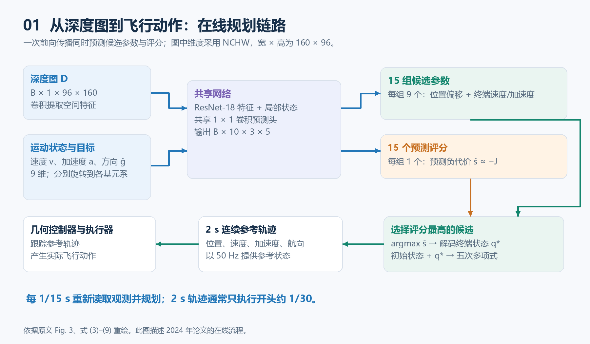
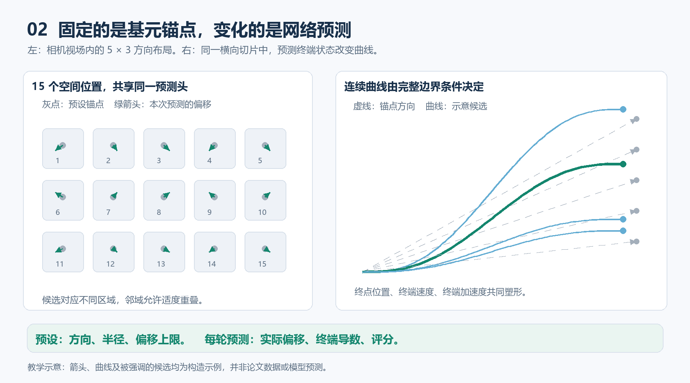
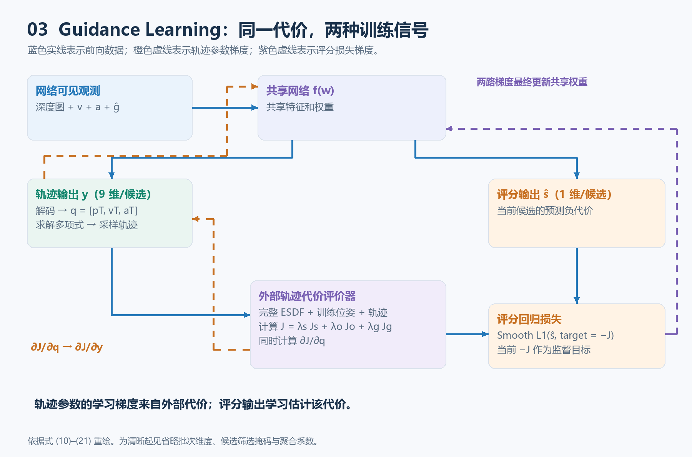
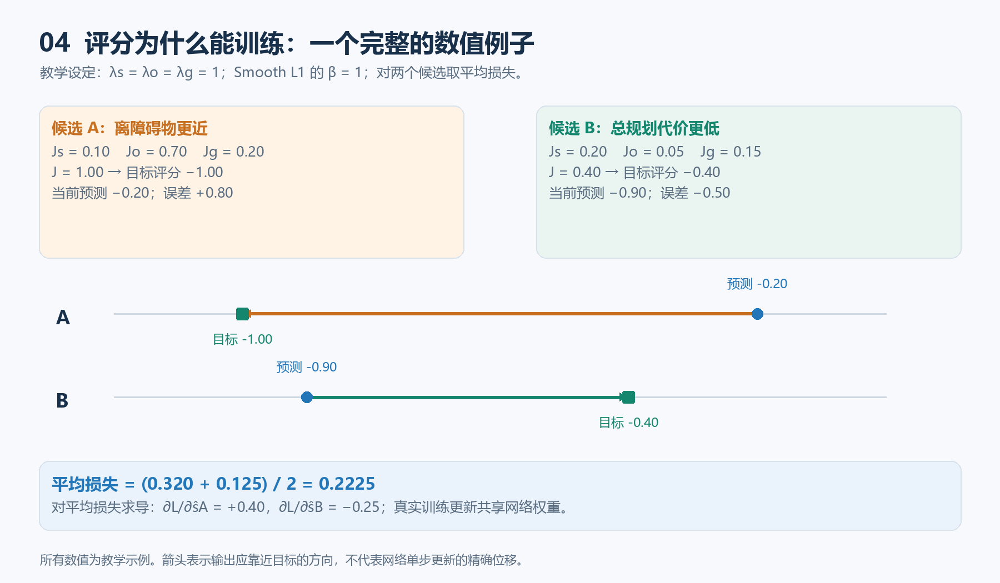

# YOPO 阅读笔记：从深度视觉到连续轨迹

> 本笔记已随复现仓库分发（`report/02_method/reading_note/`）；复现入口见[仓库 README](../../README.md)。

> 核心问题：一个网络怎样根据深度图生成局部轨迹？轨迹参数和轨迹评分分别从哪里获得学习信号？

| 项目 | 内容 |
| --- | --- |
| 论文 | *You Only Plan Once: A Learning-Based One-Stage Planner With Guidance Learning* |
| 作者 | Junjie Lu、Xuewei Zhang、Hongming Shen、Liwen Xu、Bailing Tian |
| 出处 | IEEE Robotics and Automation Letters，2024，9(7): 6083–6090 |
| DOI | [10.1109/LRA.2024.3399589](https://doi.org/10.1109/LRA.2024.3399589) |
| 原文 | [论文 PDF（作者版）](../../../artifacts/paper_sources/YOPO_author_version.pdf)；[作者项目主页](https://tju-air-lab.github.io/projects/YOPO/) |
| 代码 | [作者仓库](https://github.com/TJU-Aerial-Robotics/YOPO) |
| Zotero（本机） | 条目 `P3Z34EWB` · 附件 `IQA626WK`（仅本机 Zotero 可用，不作链接） |
| 状态 | 精读笔记；配套复现已完成（见[仓库 README](../../README.md)与[复现状态总览](../../01_status/02_复现状态总览.md)） |
| 整理日期 | 2026-10-08 |

**资料说明。** 本文依据用户提供的[对话文本](../../../plan/01_paper_protocol/references/YOPO_原始笔记对话_conversation.txt)重新组织，并用 Zotero 中的原文校核公式、结构和实验数字。分享网页正文未成功直接读取，后续以用户提供的文本为准。页码指附带 PDF 的页序，不是期刊页码。四张配图为本笔记自行绘制，其依据和示意性质见图注。

**阅读导航：** 第 1–3 节建立整体认识；第 4–6 节解释视觉如何变成轨迹；第 7–9 节重点讲训练与反向传播；第 10–12 节用于二次阅读和快速查阅。

## 1. YOPO 学到了什么

YOPO 是一个面向四旋翼的学习式局部轨迹规划器。输入是当前深度图、速度、加速度和目标方向；网络一次前向传播，同时给出多组候选轨迹的终端状态参数及评分。系统选择评分最高的一组，用起终点边界条件求出连续时间多项式，再交给几何控制器跟踪。

它把传统规划中计算昂贵的在线搜索和迭代优化，转化成离线学习得到的快速映射。连续轨迹表示、状态估计和底层控制仍然发挥作用。

| 核心对象 | 负责什么 |
| --- | --- |
| 运动基元锚点 | 为多个候选划分初始方向和局部解空间 |
| 轨迹参数输出 | 根据观测修正终点，预测终端速度和加速度 |
| 评分输出 | 估计当前候选的负规划代价，用于在线选择 |
| 外部代价评价器 | 训练时利用完整环境计算代价及梯度 |

“视觉到动作”在这里具体表现为：**视觉 → 轨迹参数 → 连续参考轨迹 → 控制器 → 执行器**。网络的终端加速度首先用于确定参考曲线，不能直接当作电机指令。

依据：原文第 2–4 页，Fig. 3，式 (1)–(9)。

## 2. 为什么采用多个候选

前方有树时，向左和向右绕行都可能可行。这是规划的多模态性：相同观测存在多个合理解。把所有解压进单一回归输出，可能得到两种策略之间的不良折中。

YOPO 借鉴 YOLO 中“锚点 + 偏移”的结构。在相机视场内预先布置多个方向，让每个输出位置主要负责自己的局部解空间，再预测该候选的改进量与质量。

这里的“并行”指共享网络的张量计算：多个空间位置同时输出候选参数。它不要求 15 个 CPU 线程分别运行搜索器。

论文实验使用 **5 个水平位置 × 3 个竖直位置 = 15 个候选**。这是实验配置，不是 YOPO 思想所要求的固定常数。分散候选有助于探索多种绕行方式，但不证明已经穷尽所有路径拓扑。

## 3. 沿着在线流程走一遍



*图 1｜依据原文 Fig. 3、式 (3)–(9) 重绘。蓝色连接观测与网络，绿色连接轨迹生成和执行。*

一次规划依次完成：

1. 获取深度图，以及当前速度、加速度和目标方向。
2. 提取图像特征，将状态变换到各基元坐标系，拼接特征。
3. 共享预测头同时输出 15 组轨迹参数和 15 个评分。
4. 选择评分最高的候选，解码其终端位置、速度、加速度。
5. 将当前状态和终端状态代入边界值问题，求出五次多项式。
6. 向几何控制器提供参考位置、速度、加速度和航向。

论文设置规划时域为 **2 s**、重规划频率为 **15 Hz**，参考状态输出频率为 **50 Hz**。约每 66.7 ms 就会重新规划，因此通常只执行一条 2 s 轨迹开头约 1/30 的部分。

“Only Plan Once”强调每轮规划通过一次网络前向完成主要预测；飞行过程中持续滚动重规划。网络推理时间、重规划周期与参考状态输出周期是三个不同概念。

## 4. 运动基元：固定锚点与可变偏移

### 4.1 预设终点分散搜索方向

以本轮规划开始时的机体局部坐标系表示，第 $(i,j)$ 个锚点为：

$$
\mathbf p_{ij}^{\mathrm{anchor}}=
\begin{bmatrix}
r\cos\theta_j\cos\phi_i\\
r\cos\theta_j\sin\phi_i\\
r\sin\theta_j
\end{bmatrix}.
$$

$\phi_i$ 为水平方位角，$\theta_j$ 为竖直方向角，$r$ 为基准规划半径。基元在状态格点空间定义，不需要在线先生成一套固定的完整多项式。

### 4.2 实际修正量由网络预测

网络输出原始值 $y_\theta,y_\phi,y_r$，经过有界解码：

$$
\Delta\theta=d_\theta\tanh(y_\theta),\qquad
\Delta\phi=d_\phi\tanh(y_\phi),\qquad
\Delta r=d_r\tanh(y_r).
$$

然后计算 $r'=r+\Delta r$、$\phi'=\phi_i+\Delta\phi$、$\theta'=\theta_j+\Delta\theta$，再用相同的球坐标转换得到预测终点 $\mathbf p_T$。

| 由配置预设 | 每次前向传播重新预测 |
| --- | --- |
| 基元数量、初始方向、基准半径 | 实际位置偏移 $\Delta\theta,\Delta\phi,\Delta r$ |
| 偏移范围 $d_\theta,d_\phi,d_r$ | 终端速度、终端加速度 |
| 规划时域与输出缩放参数 | 当前候选评分 |

**偏移上限固定，不代表偏移值固定。** 训练结束后网络权重不再改变，不同的观测和状态仍会产生不同输出。



*图 2｜左侧为 15 个基元位置及其偏移；右侧仅示意一个切片中的候选曲线。曲线是教学构造，并非论文实验轨迹或模型预测。*

有界偏移帮助各基元保持不同的空间职责。原文让局部范围略大于网格视场，因此相邻区域可以重叠。终点属于某个区域，也不意味着整条曲线被限制在相应视锥内。

依据：原文第 3–4 页，Fig. 4，式 (3)、(4)、(8)、(9)。

## 5. 把输入输出的维度和坐标系对齐

### 5.1 图像与状态怎样进入网络

实验图像缩放为**宽 160 × 高 96**，经 32 倍下采样得到**宽 5 × 高 3** 的特征网格。主干是修改后的 ResNet-18，预测头采用共享权重的 $1\times1$ 卷积。

本文统一约定：图像尺寸写“宽 × 高”，张量采用 NCHW。设批次大小为 $B$：

| 数据 | 形状或维度 | 说明 |
| --- | --- | --- |
| 深度图 | $B\times1\times96\times160$ | 单通道深度观测 |
| 图像特征 | $B\times C\times3\times5$ | $C$ 为特征通道数，具体配置需查实现 |
| 机体系状态 | $B\times9$ | 速度、加速度、目标单位方向各 3 维 |
| 基元系状态 | $B\times9\times3\times5$ | 每个基元都有相应的坐标变换 |
| 网络输出 | $B\times10\times3\times5$ | 可重排为 $B\times15\times10$ |
| 轨迹原始参数 | $B\times15\times9$ | 每候选 9 个轨迹输出 |
| 评分 | $B\times15$ | 每候选 1 个分数 |

论文中的 $M_\phi\times M_\theta\times10=5\times3\times10$ 按水平、竖直、通道排列，与上述表达对应同样的 15 个候选。

各输出位置与候选方向关联，但卷积感受野可以覆盖更广的上下文，不能理解成 15 张互不相干的小图。

### 5.2 为什么引入基元坐标系

相似视觉特征出现在左侧和右侧基元时，所需修正可能相反。将状态表达为“相对于这个候选方向”的量，可以让共享预测头学习更一致的局部规则。

记：

$$
R_{ij}=R_z(\phi_i)R_y(-\theta_j).
$$

按原文式 (7)、(9) 的实际变换关系，机体系向量转到基元系使用 $R_{ij}^{-1}$，基元系终端导数转回机体系使用 $R_{ij}$。实现时以这组关系核对方向，避免只凭矩阵的文字名称判断。

9 维状态应分别旋转三个 3 维向量：

$$
\mathbf x'_{ij}=
\begin{bmatrix}
R_{ij}^{-1}\mathbf v_0\\
R_{ij}^{-1}\mathbf a_0\\
R_{ij}^{-1}\hat{\mathbf g}
\end{bmatrix}.
$$

不能直接用一个 $3\times3$ 矩阵乘 $9\times1$ 向量；也可使用块对角矩阵 $\operatorname{diag}(R^{-1},R^{-1},R^{-1})$。

终端导数由输出解码，例如：

$$
\mathbf v_T=R_{ij}\tanh(\mathbf y_v)v_{\max},\qquad
\mathbf a_T=R_{ij}\tanh(\mathbf y_a)a_{\max}.
$$

这里对基元系输出分量限幅，不能直接解释为对整条轨迹速度模长、推力或角速度的严格约束。

### 5.3 每个候选的 10 个数

$$
\mathbf y_i=
[y_\theta,y_\phi,y_r,\mathbf y_v^{\mathsf T},\mathbf y_a^{\mathsf T},\hat s_i]^{\mathsf T}.
$$

前 9 个经过偏移、限幅与旋转，得到有物理意义的终端状态：

$$
\mathbf q_i=[\mathbf p_{T,i}^{\mathsf T},\mathbf v_{T,i}^{\mathsf T},\mathbf a_{T,i}^{\mathsf T}]^{\mathsf T}\in\mathbb R^9.
$$

第 10 个 $\hat s_i$ 预测该候选的负代价。评分与轨迹参数从共享特征中同时产生；评分功能不是另一个接收完整曲线、在线查询地图的独立评价网络。

## 6. 为什么终端状态能确定连续轨迹

### 6.1 六个边界条件确定一个五次多项式

对任一轴 $\mu\in\{x,y,z\}$，写成：

$$
p_\mu(t)=c_0+c_1t+c_2t^2+c_3t^3+c_4t^4+c_5t^5.
$$

用 $c_k$ 表示系数，避免与加速度 $a_0$ 混淆。起终点各给出位置、速度和加速度，共六个边界条件：

$$
M(T)\mathbf c_\mu=
\begin{bmatrix}p_0&v_0&a_0&p_T&v_T&a_T\end{bmatrix}^{\mathsf T},
$$

$$
M(T)=
\begin{bmatrix}
1&0&0&0&0&0\\
0&1&0&0&0&0\\
0&0&2&0&0&0\\
1&T&T^2&T^3&T^4&T^5\\
0&1&2T&3T^2&4T^3&5T^4\\
0&0&2&6T&12T^2&20T^3
\end{bmatrix}.
$$

当 $T>0$ 时有唯一解。固定 $T$ 后可预先计算映射，由 $\mathbf c_\mu=M(T)^{-1}\mathbf d_\mu$ 得到系数。三个轴分别求解，共 18 个系数。

初始状态来自状态估计；本次局部坐标原点下初始位置为零。网络只需提供 9 维终端状态，不必回归所有系数或大量离散点。

**终点相同，终端速度和加速度不同，整条曲线仍会不同。** 这就是边界状态比单个局部目标位置更丰富的原因。

### 6.2 多项式提供什么保证

单段多项式提供连续可求导的轨迹，并精确满足边界条件；不自动保证无碰撞或满足全部动力学硬约束。

滚动重规划时，新初始状态和旧参考还可能因跟踪误差而不同。因此各段平滑也不等于任意拼接后自动保持同等连续性，实际效果取决于起点选取和跟踪系统。

依据：原文第 2–4 页，式 (1)–(5)。上面的矩阵是对原文边界值映射的展开推导。

## 7. Guidance Learning：先构造可计算的规划代价

训练环境提供完整地图和位姿，外部评价器可以评估当前候选；网络本身仍只看到有限深度观测、运动状态与目标方向。

原文式 (10)：

$$
J=\lambda_sJ_s+\lambda_oJ_o+\lambda_gJ_g.
$$

“真实代价”指**按设定的规划目标与训练环境直接计算的值**，并非实际闭环飞行长期收益或安全性的完整真值。

### 7.1 平滑性：对多项式直接积分

平滑项采用轨迹导数平方积分。以 jerk 代价为例：

$$
J_s=\int_0^T\|\mathbf p^{(3)}(t)\|^2\,dt.
$$

论文实验也用平方 jerk 积分衡量平滑性。这类积分可写成边界状态的二次型。将固定初始状态记为 $\mathbf d_F$，终端状态记为 $\mathbf q$：

$$
J_s=
\begin{bmatrix}\mathbf d_F\\\mathbf q\end{bmatrix}^{\mathsf T}
\begin{bmatrix}B_{FF}&B_{FP}\\B_{PF}&B_{PP}\end{bmatrix}
\begin{bmatrix}\mathbf d_F\\\mathbf q\end{bmatrix}.
$$

采用列向量梯度，利用二次型矩阵对称性：

$$
\nabla_{\mathbf q}J_s=2B_{PF}\mathbf d_F+2B_{PP}\mathbf q.
$$

它与原文式 (14) 的行向量写法等价。具体导数阶次、权重及归一化仍应对照论文对应版本代码。

### 7.2 避障：距离场提供距离与梯度

ESDF 提供位置到障碍物的距离 $d(\mathbf p)$ 及距离场梯度。原文势函数为：

$$
c(\mathbf p)=\exp\left(-\frac{d(\mathbf p)-d_0}{k}\right),\qquad
J_o=\int_0^T c(\mathbf p(t))\,dt
\approx\sum_n c(\mathbf p(t_n))\Delta t.
$$

距离越小，代价越大。在固定时间、自由终点的设置下，时间积分能缓解通过缩短路程来降低路径累计代价的偏差。

给定距离和距离梯度：

$$
\nabla_{\mathbf p}c=-\frac{c}{k}\nabla_{\mathbf p}d,
\qquad
\nabla_{\mathbf q}J_o\approx
\sum_n\left(\frac{\partial\mathbf p(t_n)}{\partial\mathbf q}\right)^{\mathsf T}
\nabla_{\mathbf p}c\,\Delta t.
$$

地图查询不一定能由深度学习框架直接自动微分；评价器提供数值梯度后，可以把梯度传回前面的计算链。

评价时需把局部轨迹转换到地图坐标，例如：

$$
\mathbf p^W(t)=\mathbf p_0^W+R_{WB,0}\mathbf p^B(t).
$$

这解释了评价器为什么需要位置和姿态。网络未把全局位姿作为额外输入，不代表整个飞行系统不需要定位。

### 7.3 目标：朝向局部目标

将最终目标投影到无人机周围的固定半径球面，得到 $\mathbf g_{\mathrm{local}}$：

$$
J_g=\|\mathbf p_T-\mathbf g_{\mathrm{local}}\|^2,\qquad
\nabla_{\mathbf p_T}J_g=2(\mathbf p_T-\mathbf g_{\mathrm{local}}).
$$

临时目标位置与网络输入的单位方向 $\hat{\mathbf g}$ 应使用不同记号。

三项代价由研究者设计，评价器计算数值与梯度；不需要先训练价值网络，也无需为获得每条候选的反馈而实际飞完该轨迹。

依据：原文第 4–5 页，式 (10)–(20)。

## 8. 一个代价，怎样训练两种输出



*图 3｜蓝色为前向数据，橙色为轨迹参数梯度，紫色为评分损失梯度。完整地图只进入训练评价器，两种学习信号最终作用于共享网络权重。*

### 8.1 轨迹参数：代价梯度传回生成它的网络

设网络权重为 $\mathbf w$，观测为 $\mathcal O$，第 $i$ 个候选的原始输出与解码关系为：

$$
\mathbf y_i^{\mathrm{traj}}=f_{\mathbf w}^{\mathrm{traj}}(\mathcal O)_i,
\qquad \mathbf q_i=h_i(\mathbf y_i^{\mathrm{traj}}).
$$

外部评价器提供 $\nabla_{\mathbf q_i}J_i$。由链式法则：

$$
\nabla_{\mathbf w}J_i=
\left(\frac{\partial\mathbf y_i^{\mathrm{traj}}}{\partial\mathbf w}\right)^{\mathsf T}
\left(\frac{\partial\mathbf q_i}{\partial\mathbf y_i^{\mathrm{traj}}}\right)^{\mathsf T}
\nabla_{\mathbf q_i}J_i.
$$

传统优化器用这类梯度更新当前轨迹变量；YOPO 继续传给“生成轨迹变量的网络”，改善后续预测。**这条路径来自外部规划代价，不需要经过预测评分来评价轨迹参数。**

### 8.2 评分：回归当前候选的负代价

同一候选还输出评分 $\hat s_i$。代价越小越好，因此目标评分为：

$$
s_i^{\mathrm{target}}=-J_i,
\qquad L_{\mathrm{score}}=\operatorname{SmoothL1}(\hat s_i,-J_i).
$$

评分有直接计算出的回归目标，可以按普通监督回归反向传播。在线选择 $i^*=\arg\max_i\hat s_i$；评分足够准确时，近似选中代价最低的候选。

评分是负规划代价的估计，不能解释为经过校准的碰撞概率或成功概率。

### 8.3 两种信号如何共存

网络共享特征，但两种输出接受不同学习信号：

| 输出 | 学习依据 | 要学会的能力 |
| --- | --- | --- |
| 轨迹参数 | $\nabla_{\mathbf q}J$ 经解码链回传 | 生成更低代价的候选 |
| 评分 | 预测与当前 $-J$ 的误差 | 估计候选的相对质量 |

原文采用候选筛选：所有候选训练评分，终端状态梯度仅用于符合筛选条件的候选。阈值比较方向、分数尺度及代码中的掩码实现，还需核对指定版本代码。

轨迹随网络更新而改变，因此每轮重新计算其代价和评分目标。目标不是某个基元永久固定的标签。

实现评分回归时，通常把当前 $-J$ 作为固定目标，避免评分误差经目标端额外改变轨迹。`detach()` 是表达这一分工的常见方式；**这是根据算法意图给出的实现解释，并非已核实的作者代码原句。**

### 8.4 与 Actor-Critic 的联系和区别

| 问题 | 常见 Actor-Critic | YOPO 本文 |
| --- | --- | --- |
| 评价对象 | 动作及后续策略的累计回报 | 当前有限时域轨迹的规划代价 |
| 评价目标来源 | 奖励、回报或 Bellman 目标等 | 完整训练地图 + 预设代价 |
| 策略训练梯度 | 依算法而定，常借助价值/优势估计 | 外部代价对轨迹参数的梯度 |
| 评分学习 | 常涉及时间回报估计或自举 | 回归当前候选的 $-J$ |
| 是否需执行候选才能算反馈 | 取决于算法与环境模型 | 主规划代价可直接计算 |

这是对常见 Actor-Critic 的比较，不是对所有强化学习方法的统一定义。YOPO 仍然用仿真采集数据，并采用数据聚合进一步微调。

作者称其为无监督训练，准确理解是：**不依赖专家最优轨迹示范，但依赖人为代价、环境特权信息和计算出的监督信号。**

## 9. 用数字看清两种训练

### 9.1 评分学习：纠正候选排序

以下均为教学数据，假设三个代价权重都是 1：

| 项目 | 候选 A | 候选 B |
| --- | ---: | ---: |
| 平滑性 $J_s$ | 0.10 | 0.20 |
| 避障 $J_o$ | 0.70 | 0.05 |
| 目标 $J_g$ | 0.20 | 0.15 |
| 合计 $J$ | 1.00 | 0.40 |
| 目标 $-J$ | -1.00 | -0.40 |
| 当前预测 $\hat s$ | -0.20 | -0.90 |

当前预测会选 A，但按训练评价器应选 B。



*图 4｜蓝点是预测，绿方块是目标，箭头是误差应减小的方向。所有数字为教学构造。*

设 Smooth L1 的 $\beta=1$，当前两种误差绝对值都小于 1，使用二次段：

$$
e_A=0.80,\quad e_B=-0.50,\qquad
\ell_A=\tfrac12(0.8)^2=0.32,\quad
\ell_B=\tfrac12(-0.5)^2=0.125.
$$

若采用两个候选的**平均损失**：

$$
L=\frac{\ell_A+\ell_B}{2}=0.2225,
\qquad
\frac{\partial L}{\partial\hat s_A}=0.40,
\quad
\frac{\partial L}{\partial\hat s_B}=-0.25.
$$

对单个损失 $\ell_A,\ell_B$ 的导数才分别为 $0.80,-0.50$。原始对话先使用平均损失，后展示单样本导数，容易漏掉 $1/2$，这里明确区分。

只为观察方向，暂把评分当作两个独立变量，取步长 0.1，一次更新后得到 $-0.24$ 和 $-0.875$。两者都更接近目标，但一次更新未必纠正排序。真实训练更新共享网络权重，输出与样本之间会相互影响。

### 9.2 轨迹学习：无需给出唯一标准终点

考虑标量教学例子 $y_T=\tanh(z)$。当前 $z=0.5$，评价器给出 $\partial J/\partial y_T=2$，则：

$$
\frac{\partial J}{\partial z}=2\bigl(1-\tanh^2(0.5)\bigr)\approx1.573.
$$

演示性地用步长 0.1 更新这个标量：

$$
z_{\mathrm{new}}\approx0.343,\qquad
y_T:\ 0.462\rightarrow0.330.
$$

只要知道改变输出会如何影响代价，就有局部优化方向，不必先给唯一“正确轨迹”。有限步长下的真实代价变化仍取决于具体函数；此处只演示链式法则。

## 10. 并排看训练与推理的数据流

| 环节 | 训练阶段 | 在线推理阶段 |
| --- | --- | --- |
| 网络输入 | 深度、速度、加速度、目标方向 | 相同类型的可观测输入 |
| 网络输出 | 15 组参数与评分 | 15 组参数与评分 |
| 候选轨迹求解 | 为计算代价与梯度生成候选 | 只需求解最终选中的候选 |
| 完整地图与位姿 | 供外部训练评价器使用 | 在线规划不依赖训练用完整 ESDF |
| 规划代价 $J$ | 直接计算并指导训练 | 用预测评分估计质量 |
| 反向传播 | 两种信号更新共享权重 | 无 |
| 控制器执行 | 主训练反馈不要求逐条闭环执行 | 跟踪选中轨迹、持续重规划 |

论文用 Flightmare 预采集约 **100K 样本**，训练 **50 个 epoch**，batch size **16**，学习率 $1.5\times10^{-4}$。同一深度样本可配不同速度、加速度与目标方向，重新计算代价，无需重新生成专家轨迹标签；论文还采用数据聚合进一步微调。

下面是补写的教学伪代码，**不是作者仓库代码**。原始对话中训练代码块未完整抓取。这里省略具体权重、归一化和布局转换。

```python
# 训练：说明数据与梯度依赖
raw_traj, scores = network(depth, velocity, acceleration, goal_dir)
terminal = decode_primitives(raw_traj)  # [B, 15, 9]
trajectories = solve_polynomials(initial_state, terminal)

cost, grad_terminal = evaluate_cost_and_gradient(
    trajectories, terminal, privileged_map, training_pose, local_goal
)
grad_raw = decoder_vector_jacobian_product(raw_traj, grad_terminal)
mask = select_training_candidates(cost, scores)  # 筛选规则待代码核对

optimizer.zero_grad()
raw_traj.backward(gradient=mask[..., None] * grad_raw, retain_graph=True)
score_loss = smooth_l1(scores, (-cost).detach())
score_loss.backward()
optimizer.step()
```

```python
# 推理：参数与评分来自同一次前向
raw_traj, scores = network(depth, velocity, acceleration, goal_dir)
best = scores.argmax(dim=-1)
terminal = decode_selected_primitive(raw_traj, best)
trajectory = solve_polynomial(initial_state, terminal, duration=2.0)
send_reference_to_controller(trajectory)
# 以论文设置的 15 Hz 接收观测并继续规划
```

这些函数只表示职责。实际实现还需要候选掩码、正确的向量-Jacobian 乘积、聚合尺度和计算图生命周期管理，不能将伪代码当作可运行复现。

## 11. 实验：哪些数字支持哪些结论

### 11.1 与有限迭代专家比较

原文表 I（PDF 第 6 页）：

| 方法 | 平均候选代价 | 最优候选代价 | 耗时 |
| --- | ---: | ---: | ---: |
| 梯度优化专家 | 0.078 | 0.036 | 30 ms |
| 网络，训练后 | 0.050 | 0.036 | 1.6 ms |

专家从基元初值出发做 50 步梯度下降，网络训练 50 个 epoch。结果支持网络学到有效的快速映射，并在该实验的平均候选代价上优于所比较的专家；不能证明优于所有优化器，也不构成全局最优保证。

### 11.2 仿真的速度、安全性与平滑性

原文表 II（PDF 第 7 页）总延迟：TopoTraj 61.9 ms、MPPI 19.7 ms、Agile Autonomy 5.4 ms、YOPO 1.6 ms。平台为 i7-9700 与 RTX 3060。

在平均速度 4 m/s、障碍密度 1/20 tree/m² 的对比中：

| 方法 | 平均障碍距离 / m | 最小障碍距离 / m | 平滑性代价 / m²·s⁻⁵ |
| --- | ---: | ---: | ---: |
| TopoTraj | 1.00 | 0.08 | 810.17 |
| MPPI | 0.94 | 0.06 | 16.83 |
| Agile Autonomy | 1.01 | 0.10 | 2954.46 |
| YOPO | 1.28 | 0.16 | 73.52 |

此设置下 YOPO 的障碍间距更好，MPPI 的平滑性更好。原文也指出更高速度、密集场景下 Agile Autonomy 更有竞争力，不能写成 YOPO 在所有速度和指标上都最优。

### 11.3 真实飞行

原文第 7–8 页：D455 深度相机、VINS-Fusion 状态估计、Xavier NX 机载计算、几何控制器；TensorRT 部署后的网络推理约 **16 ms**，森林飞行最高速度 **5.52 m/s**。

**桌面 1.6 ms 与机载 16 ms 属于不同平台。** 两者均不能直接当作整条感知—规划—控制链路的端到端延迟。

## 12. 二次阅读时最容易混淆的九件事

| 易混淆的表述 | 准确理解 |
| --- | --- |
| 15 个固定动作中选一个 | 固定锚点附近预测可变终端状态，再选择 |
| 15 个区域各运行搜索线程 | 共享网络并行产生多个空间位置的输出 |
| 只输出 2 s 后的位置 | 还输出终端速度、加速度与评分 |
| 网络直接输出多项式系数 | 输出边界参数，系数由解析映射得到 |
| 在线生成全部曲线再查询地图评分 | 参数与评分同时预测，只需求解选中曲线 |
| 轨迹分支经学出的评分反传 | 主轨迹梯度来自外部代价评价器 |
| 无监督意味着没有监督信号 | 无专家轨迹标签；有代价与评分目标 |
| 终端限幅保证全程安全可执行 | 限幅与软代价改善表现，不构成全程硬约束证明 |
| 特权训练让网络知道所有遮挡内容 | 部署仍受有限视野和部分可观测性限制 |

由其观测设置可以进一步推论：遇到严重遮挡、异常观测或训练分布之外的场景时，快速预测的评分可能失准。原文证明了特定场景中的有效性，没有给出任意未知环境的完整安全保证。

## 13. 后续阅读与实现核对

- [ ] 确认论文对应代码中的代价权重、归一化和时间采样间隔。
- [ ] 确认终端导数缩放的分量含义及坐标变换约定。
- [ ] 确认评分目标符号、筛选阈值及掩码比较方向。
- [ ] 确认自定义梯度、评分目标停止梯度及聚合尺度。
- [ ] 检查重规划起点来自当前估计还是旧参考，分析拼接连续性。
- [ ] 用简单障碍场景比较有限差分与解析/数值梯度。
- [ ] 研究 MINCO 时，比较轨迹参数化改变后梯度链如何变化。

作者仓库已有后续重构版本和 MINCO 分支。当前仓库说明将与论文一致的稳定版本指向 `main`；复现时应记录具体 commit，避免把新版轨迹表示或部署指标写回 2024 年原文。

## 附录 A：符号速查

| 符号 | 含义 |
| --- | --- |
| $D$、$\mathcal O$ | 深度图；完整网络可见观测 |
| $\hat{\mathbf g}$ | 网络输入的目标单位方向 |
| $\mathbf g_{\mathrm{local}}$ | 目标代价中的临时目标位置 |
| $(r,\theta_j,\phi_i)$ | 基元球坐标参数 |
| $\mathbf y_i^{\mathrm{traj}}$ | 9 维原始轨迹输出 |
| $\mathbf q_i$ | 解码后的终端位置、速度、加速度 |
| $\hat s_i$、$J_i$ | 预测评分；外部计算的规划代价 |
| $\mathbf c_\mu$、$M(T)$ | 单轴多项式系数；边界映射矩阵 |
| $\mathbf w$ | 网络权重 |
| $B$、$C$ | 批次大小；特征通道数 |

## 附录 B：来源与维护

1. [论文 PDF（作者版）](../../../artifacts/paper_sources/YOPO_author_version.pdf)：与 Zotero 附件 `IQA626WK` 内容一致，共 8 页。书目信息来自 Zotero 期刊条目与 DOI；文件保留作者排版和原有修订颜色。
2. [原始对话文本](../../../plan/01_paper_protocol/references/YOPO_原始笔记对话_conversation.txt)：用户提供，正文已去重、重排并核对。
3. [原始分享链接](https://chatgpt.com/share/6ac753d1-a6dc-83e8-80d3-e41a395cf153)：网页识别到标题，正文以用户提供文本为准。
4. [作者项目主页](https://tju-air-lab.github.io/projects/YOPO/)与[公开原文](https://tju-air-lab.github.io/projects/YOPO/YOPO.pdf)。
5. [作者代码仓库](https://github.com/TJU-Aerial-Robotics/YOPO)：本笔记尚未逐行验证实现。
6. [配图生成脚本](tools/generate_figures.py)：用 Pillow 和微软雅黑生成四张原创教学图，不依赖外部图片。

**2026-10-08 整理记录：** 合并重复问答；统一宽高及 NCHW；修正 9 维状态旋转的维度表达；区分系数和加速度符号；明确平均评分损失的梯度系数；补写教学伪代码；添加四张静态配图与原文实验定位。

**命名约定：** 本笔记在复现仓库中以 `README.md` 随 `reading_note/` 分发（来源笔记仓库中曾名 `papernote.md`）。

[返回论文总目录](../README.md)
