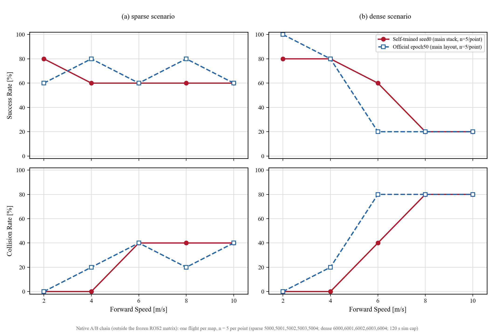

# 官方权重 vs 自训练权重对照

更新：2026-10-12 ｜ 论文对应：III-A（Table I 网络 vs 专家）、III-B（Table II 基线对比）｜ 证据来源：2026-09-26 批量闭环对照与 2026-10-08 离线对照的既有原始 JSON，未新增飞行

本文汇总两类权重的全部可核验对照：官方 YOPO-Simple epoch50 权重，与本地从头训练的三个正式种子（formal_main_v1）。结论只覆盖已记录的实验范围。

## 1. 对照对象与身份

| 类别 | 权重 | SHA256 | 说明 |
|---|---|---|---|
| 官方（原生 Simple 布局） | [external/audit_sources/YOPO-Simple/YOPO/saved/YOPO_1/epoch50.pth](../../external/audit_sources/YOPO-Simple/YOPO/saved/YOPO_1/epoch50.pth) | `09ec3109…229f` | 官方发布预训练权重，45,264,872 B |
| 官方（main 布局映射） | `checkpoints/official_epoch50_reference/best_policy.pth`（外部归档：官方权重转换参考；官方原件见 external/audit_sources/YOPO-Simple/YOPO/saved/YOPO_1/epoch50.pth）（等同 [artifacts/expert/official_epoch50_policy_layout.pth](../../artifacts/expert/official_epoch50_policy_layout.pth)） | `7d5dc46f…a94e` | 7 个键名映射进 main 布局，张量不变，见 [official_checkpoint_mapping.json](../../artifacts/expert/official_checkpoint_mapping.json) |
| 自训练 seed0 | [checkpoints/formal_main_v1_seed0/best_policy.pth](../../checkpoints/formal_main_v1_seed0/best_policy.pth) | `af2ea0fa…f274` | 50 轮 / 312,500 步，随机初始化，最佳轮 50 |
| 自训练 seed1 | checkpoints/formal_main_v1_seed1/best_policy.pth | `908e79f6…94c8` | 最佳轮 47（哈希记录于 training_audit.json） |
| 自训练 seed2 | checkpoints/formal_main_v1_seed2/best_policy.pth | `eaf157f7…6c1d` | 最佳轮 50（哈希记录于 training_audit.json） |

官方权重不加载进训练器（`official_weights_loaded=false`），只用于部署与对照；自训练权重由本仓库完整审计链产生。

## 2. 离线对照（10,000 样本，Table I 口径）

独立测试集地图 2000–2003；网络候选与专家候选都由同一原版 C++ 目标函数评分，未根据测试结果调参。完整表见 [table_i_expert_vs_network.md](../../artifacts/paper_figures/table_i_expert_vs_network.md)与[专家50步比较](../03_training/03_专家50步比较.md)。

| 来源 | 平均候选代价 | 最优候选代价 | 与 scaled_gd50 最优一致率 |
|---|---:|---:|---:|
| 随机初始化 | 0.082267 | 0.039556 | 0.1486 |
| 自训练 seed0 | **0.023062** | **0.017855** | **0.2261** |
| 自训练 seed1 | 0.023073 | 0.017867 | 0.2238 |
| 自训练 seed2 | 0.023072 | 0.017882 | 0.2204 |
| 官方 epoch50 | 0.029614 | 0.021963 | 0.1521 |
| 专家 scaled_gd50（重建） | 0.024253 | 0.021824 | — |
| 专家 mma50（重建） | 0.021451 | 0.018753 | — |

读法：单看该离线集，自训练 seed0 相对官方平均代价低约 22.1%、最优候选低约 18.7%、一致率高约 7.4 个百分点；但自训练平均代价仍弱于 mma50 专家重建，最优候选优于两个专家重建。原论文绝对数字的场景、代价尺度、实现与硬件不同，不作为逐项数值复现声明。

## 3. 闭环对照（36 架次，场景 × 速度 × 栈）

设计：3 个程序化森林场景（简单 5002 / 中等 5004 / 困难 5001）× 3 档速度（2/4/6 m/s）× 4 个「栈 × 权重」组合；每格 1 架次、上限 120 s；判定为终点误差 <0.5 m 且速度 <0.2 m/s 连续 1 s 且无碰撞。全量原始记录见 [batch_summary.json](../../artifacts/weights_ab_demo/batch_summary.json)与 [batch_analysis.json](../../artifacts/weights_ab_demo/batch_analysis.json)。

| 组合（栈×权重） | 成功 | 超时 | 碰撞 | 入圈中位（1 m） | 稳定达标中位 | 跟踪 RMSE 中位 | 网络时延中位 |
|---|---:|---:|---:|---:|---:|---:|---:|
| Simple 栈 + 官方 | 8/9 | 1 | 0 | 6.82 s | **9.28 s** | 0.249 m | 4.5 ms |
| Simple 栈 + 自训练 seed0 | 8/9 | 1 | 0 | 11.75 s | 14.18 s | 0.235 m | 4.5 ms |
| main 栈 + 官方 | 7/9 | 1 | 1 | **4.61 s** | 11.28 s | 1.103 m | 16.5 ms |
| main 栈 + 自训练 seed0 | 7/9 | 1 | 1 | 13.93 s | 16.07 s | **0.512 m** | 16.2 ms |

**判据与时间口径**：本批次（legacy 闭环）的 success 判据为终点误差 <0.5 m 且速度 <0.2 m/s 连续 1 s、无碰撞；`arrival_time_s` 记录首次进入终点 **1 m** 半径（终端保持的切换点）的时刻，「稳定达标」为持续条件满足、episode 正常结束的时刻。终点附近可见的折返成因：`run_navigation.py` 在首次进入 1 m 半径时切换为低带宽终点位置保持（姿态增益减半；水平位置/速度增益 0.08/0.12；积分清零），且切换只看距离不看速度——入圈时官方仍有 ≈4.9 m/s、自训练 ≈3.8 m/s 的水平速度（场景 5001 · 4 m/s），低增益回路无法立刻抵消动量，因此过冲（官方最远 2.04 m @5.5 s；自训练 1.70 m @8.2 s）后被缓慢拉回；折返即过冲回稳弧线，与判据无关（判据只决定何时计为完成并终止 episode）。标注图见 [04_terminal_phase.png](../05_visualization/media/official_vs_selftrained/04_terminal_phase.png)。

按速度的成功数（官方/自训练，Simple 与 main 两栈）：

| 速度 | Simple 官方 | Simple 自训练 | main 官方 | main 自训练 |
|---:|---|---|---|---|
| 2 m/s | 2/3 | **3/3** | 2/3 | **3/3** |
| 4 m/s | **3/3** | **3/3** | **3/3** | 2/3 |
| 6 m/s | **3/3** | 2/3 | 2/3 | 2/3 |

关键结论（与[权重批量对照实验](02_权重批量对照实验.md)一致）：

- 成功率分不出两类权重：同栈下观察成功数相同（8/9 与 8/9、7/9 与 7/9），每格仅 1 架次，不具统计显著性。
- 权衡点不同：官方入圈更早（main 栈 4.61 s vs 13.93 s），但过冲回稳更久（稳定达标 11.28 s vs 16.07 s，官方仍更快）；自训练跟踪更准（main 栈 RMSE 中位 0.512 m vs 1.103 m；官方在 6 m/s 单格最高 4.77 m）。
- 栈的匹配效应大于权重差异：同一权重换栈引起的 RMSE 变化幅度大于换权重，不能单独归因于权重退化。
- 失败模式：4 个超时都是「飞得动但收敛不到终点」（航迹 134–352 m）；2 个碰撞都发生在 6 m/s，安全裕度主要被速度与场景吃掉。
- 场景相关：官方在 main 栈的旧网格场景曾两次超时，但在 3 个森林场景 7/9 成功——单点结论不可推广。

## 3.1 速度与密度扩展补测（2026-10-14，82 架次，原生 main 链）

原 A/B 只覆盖稀疏场景 2/4/6 m/s、每格 1 架次。为把「不同速度」的官方对照补全并加大样本，2026-10-14 在同一原生链、同一任务设定下分两批补跑 **82 架次**，把稀疏与稠密都扩到 **5 张地图 × 5 档速度 × 2 臂、每格 n=5**：

- 第一批（42 架次）：稀疏 8/10 m/s（5001/5002/5004）+ 稠密（6001/6002/6004）2–10 m/s；
- 第二批（40 架次）：稀疏 5000/5003 与稠密 6000/6003 的 2–10 m/s（把每格从 3 张地图扩到 5 张）。

上限 120 s，跑名 `wab2_main_{official,local}_s{scene}_v{speed}`（与既有 36 架次不重名，未改动旧记录）。原生链在同一 (地图, 速度) 下基本复现同一结果，因此扩样本通过增加地图而不是重复同一格实现。

| 场景 | 权重 | 2 m/s | 4 m/s | 6 m/s | 8 m/s | 10 m/s |
|---|---|---|---|---|---|---|
| 稀疏 1/30 | 官方 epoch50（main 布局） | S3 / C0 / T2 | S4 / C1 / T0 | S3 / C2 / T0 | S4 / C1 / T0 | S3 / C2 / T0 |
| 稀疏 1/30 | 自训练 seed0 | S4 / C0 / T1 | S3 / C0 / T2 | S3 / C2 / T0 | S3 / C2 / T0 | S3 / C2 / T0 |
| 稠密 1/20 | 官方 epoch50（main 布局） | S5 / C0 / T0 | S4 / C1 / T0 | S1 / C4 / T0 | S1 / C4 / T0 | S1 / C4 / T0 |
| 稠密 1/20 | 自训练 seed0 | S4 / C0 / T1 | S4 / C0 / T1 | S3 / C2 / T0 | S1 / C4 / T0 | S1 / C4 / T0 |

结论（每格 3 架次，不做显著性宣称）：

- 稀疏场景 2–10 m/s 合计（各 25 架次）：官方 17 成功 / 6 碰撞 / 2 超时，自训练 16 成功 / 6 碰撞 / 3 超时——两台权重基本打平。
- 稠密场景分水岭在 6 m/s：官方每档 1/5 成功、4/5 碰撞；自训练 6 m/s 仍有 3/5 成功，8 m/s 起同为 1/5 成功、4/5 碰撞。低中速段（2/4 m/s）两台权重都基本可靠，超时是主要失败模式。
- 补测期间发现 Isaac 偶发在退出阶段挂死；批量驱动新增 `--flight-timeout`（默认 420 s）墙钟保护，超时即杀进程并照常收集已写入的 metrics，避免挂死拖垮整批。
- 该补测仍是原生链，与 ROS2 冻结矩阵不同栈；论文 Fig.7 口径的矩阵曲线与逐格数值见[项目全景](../00_index/03_project_map.md) §3。

## 4. 与正式矩阵的关系

官方权重不参与 1500/1800 冻结矩阵；矩阵内 YOPO 全部为自训练三种子（另有 TopoTraj、Agile 基线，MPPI 300 槽未执行）。本文的 36 架次与离线对照均为独立 scope（`weights A/B batch outside the frozen benchmark matrix`），未触碰冻结证据。正式矩阵结果见 [summary.json](../../artifacts/benchmark_summary/summary.json)。

## 5. 展示对比（两阶段，不是受控实验）

| 阶段 | 权重 | 视频与清单 |
|---|---|---|
| 官方预训练部署阶段（2026-09 早期） | 官方 Simple epoch50 | [yopo_global_flight.mp4](../../artifacts/showcase/forest_seed7_v3/yopo_global_flight.mp4)、[render_manifest.json](../../artifacts/showcase/forest_seed7_v3/render_manifest.json)、[完成验收与成果路径](../90_archive/01_完成验收与成果路径.md) |
| 自训练最终展示（50 轮审计权重） | 自训练 seed0 | [global_trajectory.mp4](../../artifacts/ros2_showcase/showcase_formal_main_v1_seed0_20260926_014921_final/global_trajectory.mp4)、`artifacts/ros2_flights/showcase_formal_main_v1_seed0_20260926_014921/metrics.json`（外部归档：完整飞行记录与逐架次证据见 report/06_migration）（成功、RMSE 0.116 m、最小净空 1.188 m、端到端 p50 92.7 ms） |

两个展示的场景、栈与录制方式不同，只用于说明两个阶段各自能飞，不构成对照结论。

## 6. 口径与局限

- 对照样本量小：原 A/B 每格 1 架次、总 36 架次；2026-10-14 补测为每格 3 架次、42 架次（仅 main 栈）。仍不足以做显著性判断，“谁更稳”在现有样本量下不成立。
- 网络时延中位只覆盖网络管道；不含取像/渲染读取（约 43 ms）与传输，不能当端到端指标。
- 程序化森林不是官方 Flightmare 资产；官方权重在本地分布上的行为不等同官方场景表现。
- 本地离线集的优势（Table I 口径）不能外推为“训练方法普遍更优”。

## 7. 证据与复跑入口

- README 首屏对照（同场景轨迹大图 + 「轨迹/机载深度」同步动画 + 深度帧静态对照）：[report/05_visualization/media/official_vs_selftrained](../05_visualization/media/official_vs_selftrained/)（`01_same_scene_trajectories.png`、`02_same_scene_compare.gif`、`03_depth_frames.png`；前三组轨迹均为双方都到达的同类场景）；生成脚本 [scripts/make_official_vs_selftrained_figure.py](../../scripts/make_official_vs_selftrained_figure.py)。
- 逐架次原始指标：`artifacts/navigation/wab2_<arm>_s<scene>_v<speed>/metrics.json`（36 个目录）；日志见 `artifacts/weights_ab_demo/batch_logs`（外部归档：运行日志）。
- 批量驱动：[scripts/run_weights_ab_batch.py](../../scripts/run_weights_ab_batch.py)（支持 `--skip-existing` 续跑）；离线对照：[scripts/compare_expert_network.py](../../scripts/compare_expert_network.py)。
- 权重身份：官方映射记录 [official_checkpoint_mapping.json](../../artifacts/expert/official_checkpoint_mapping.json)；自训练审计 [checkpoints/formal_main_v1_seed0/training_audit.json](../../checkpoints/formal_main_v1_seed0/training_audit.json)。
