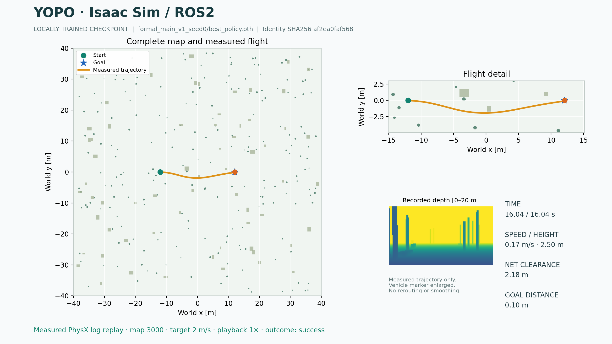

这是标题所示日期的分析快照。当前进度与历史报告范围请查看 [报告索引](../00_index/README.md) 和 [当前进度简报](../01_status/01_当前进度简报.md)；MPPI 已于 2026-10-13 移出活动范围并归档，不再是当前缺口。

# YOPO 本地复现：三个任务完整分析报告

复核日期 2026-10-02 · 时区 Asia/Shanghai · 生成时间 2026-10-02T20:33:14+08:00
任务：astraYOPO / ds-YOPO / YOPO2 · 基于本地运行证据

## 1. 总体结论与阅读口径

**本地 YOPO 从头训练、ROS2／Isaac 闭环和大部分实验已经完成；原定全部论文仿真基准尚未完成。** 当前正式覆盖为 1,500 / 1,800，覆盖率 83.33%。这只是实验槽位覆盖率，不能当成整个项目的完成百分比。

最终机器审计仍为 **5 verified + 1 documented_gap + 1 pending**，all_verified=false。尚未执行的是参考\[17\] MPPI 的 300 个槽位。碰撞与超时属于已执行实验的真实结局，不是缺失实验；“1,500 次完成”也不等于“1,500 次成功”。

本报告综合三个任务的用户要求、阶段结论和执行记录，并重新读取本地结果。重新检查了三个最佳权重与最终视频的 SHA256、逐种子的检查点数量、1,500 份正式 metrics 的结局及身份数量，以及 36 架次补充实验的原始指标一致性。本次没有重新训练、启动仿真、应用 A/B 方案或更改验收口径；也没有重新读取全部训练张量、重算全部逐帧评价。

核查日期：2026-10-02，Asia/Shanghai。当前 docker ps 报 Docker Desktop Linux engine 管道不存在，因此**本次无法验证容器内环境和立即重跑能力**；已有运行证据与文件仍可直接查看。宿主 isaac61 Python 路径存在。

权威入口：[最终验收 JSON](../../artifacts/environment/final_acceptance_audit.json)；[正式基准汇总](../../artifacts/benchmark_summary/summary.json)；[本报告复核记录](../../artifacts/report_review_20261002/review_evidence.json)。

## 2. 三个任务的关系及完整工作内容

| 任务原名 | 任务链接 | 承担的工作 | 对历史状态的解释 |
| --- | --- | --- | --- |
| astraYOPO | [打开任务](codex://threads/01a0cf36-0e8d-7ab1-9a5a-2698b7c3a559) | 可行性调研；官方权重单场景演示；制定并实施 Ubuntu 22.04／ROS2 从头训练方案；环境、数据、数值对照、早期训练和中间权重闭环。 | 先完成了官方权重展示，随后用户扩大目标；早期“已完成”不能用于新目标。 |
| ds-YOPO | [打开任务](codex://threads/01a0d125-ad70-7ad1-8b13-3f35949be5e8) | 承接训练；完成 seed0 严格审计并继续 seed1；补齐训练看护、分批矩阵、证据门、隔离重试、专家对照、DAgger 和后处理链。 | 该任务末期仍报告 seed1 15/50。最新回合失败不等于整个项目失败；后续文件已证明三种子完成。 |
| YOPO2 | [打开任务](codex://threads/01a0db55-4af3-79c2-a355-1d180ab94c10) | 承接后续成果和验收；归档正式基准、自训练最终展示和 DAgger；整理 A/B 收尾方案；接收 MPPI 全文；追加官方／本地权重离线及飞行对照、36 架次分层测试。 | 最新记录为终态看护，2026-10-02 19:43 左右仍为 5+1+1。它还引用一个中间交接任务 01a0d251…，因此不能把全部中间执行都归到这三个任务自身。 |

最终授权范围是训练与仿真，不包含真实无人机飞行。工作链为：源码与论文审计 → 独立容器和接口 → 自生成数据 → 三种子随机初始化训练 → ROS2 规划与物理闭环 → 外部基线准入 → 固定矩阵与专家对照 → DAgger 微调 → 视频、图表和验收 → 官方／本地权重补充比较。

## 3. 技术实现与运行架构

主路线是 Windows 原生 Isaac Sim 6.1 + Ubuntu 22.04 Docker + ROS2 Humble。Windows 负责实时深度、PhysX、控制和展示；容器负责训练、YOPO 规划、TopoTraj／Agile 基线及评测工具。宿主项目挂载为容器 /workspace；训练数据另暂存 Docker 专用卷的 /data/isaac_full_v1。

正式模型保留官方 main 的网络和轨迹代价语义：ResNet18、15 个轨迹候选、五次多项式；采用原版 bucket 距离场。网络输入是深度、状态、目标，地图真值用于训练或独立评价，不输入在线视觉规划器。时间同步、帧配对、过期轨迹、任务复位、时钟回跳和实际延迟均有专门实现与验证。

统一基准机体是 Fast-Planner 参数的 PhysX 等效四旋翼：0.98 kg、碰撞包络半径 0.322 m、物理步长 2 ms、控制步长 10 ms；深度 160×90、15 Hz。它与早期 Crazyflie 展示线不是同一套平台，数据不能直接混算。

paper_aligned 实际表示“对齐可运行官方 main 的数值语义”，并非论文每句话都逐项一致。公开 main 与论文文字在筛选阈值、score 符号等处有差异；Isaac 程序化森林替代原 Flightmare 场景。

| 用途 | 位置 |
| --- | --- |
| 容器服务与卷 | [compose.yaml](../../compose.yaml) |
| 原版算法配置及差异 | [report/02_method/03_原论文与源码差异审计.md) |
| 统一复现协议 | [configs/reproduction_protocol.json](../../configs/reproduction_protocol.json) |
| 基准运行配置 | [configs/benchmark_runtime/v1.json](../../configs/benchmark_runtime/v1.json) |
| ROS2 包 | [ros2_ws/src](../../ros2_ws/src) |
| 数值、训练、仿真与评测库 | [src](../../src) |
| 基线迁移记录 | [report/04_evaluation/06_ROS2基线迁移记录.md) |
| 实际运行准入 | [benchmarks/protocol_v1/runtime_validation.json](../../benchmarks/protocol_v1/runtime_validation.json) |

已有数值证据包含多项式、代价／梯度、体素／距离场、控制器与 Agile 转换对照；每份证据有自己的作用域。例如解析平面 SDF 的代价检查不单独证明真实场景全链正确，需与实际数据校验和飞行结果一起阅读。

## 4. 数据、正式训练与 DAgger 的完成情况

正式数据为 **20 张训练地图／100,000 样本，4 张验证地图／10,000 样本，4 张离线测试地图／10,000 样本**。validation.json 为 passed，记录深度、位姿、地图来源、文件哈希和按地图隔离。正式闭环另用 20 张地图，保留训练／验证／测试分离。

训练从整个网络随机初始化开始，不加载官方或 ImageNet 权重。三个种子各 50 epoch、batch 16、Adam、学习率 1.5e-4；实际训练 manifest 记载 PyTorch 2.7.1+cu128。每种子 312,500 步，合计 937,500 步。每种子保存 50 个完整 epoch 检查点和 50 个策略文件，另有 initial、latest、best、优化器与 RNG 信息；断点恢复已有等价性验证。

| seed | 轮次 | 步数 | 最佳轮次 | 最佳验证损失 | 审计 | 部署权重 |
| --- | --- | --- | --- | --- | --- | --- |
| 0 | 50 / 50 | 312,500 | 50 | 0.0229289713 | passed；本次权重哈希一致 | [best_policy.pth](../../checkpoints/formal_main_v1_seed0/best_policy.pth) |
| 1 | 50 / 50 | 312,500 | 47 | 0.0229346756 | passed；本次权重哈希一致 | [best_policy.pth](../../checkpoints/formal_main_v1_seed1/best_policy.pth) |
| 2 | 50 / 50 | 312,500 | 50 | 0.0229379733 | passed；本次权重哈希一致 | [best_policy.pth](../../checkpoints/formal_main_v1_seed2/best_policy.pth) |

权重应使用验证集选出的 best_policy.pth；seed1 的最佳轮次是 47，不能把“训练 50 轮”误读成“所有 seed 都部署第 50 轮”。离线损失很接近，但后文闭环成功率相差 7 个百分点，说明损失稳定不等于闭环表现完全一致。

DAgger 独立完成：33 架次、11 张可用新地图，增加 7,620 个样本；与基础训练组合为 107,620 个训练样本，微调 10 轮、67,260 步。result.json 为 complete，rehearsal=false、official_weights_loaded=false、writes_into_base_run=false。验证损失为 0.0229117667，相比 seed0 基础值改善约 0.075%。这只能说明微调及该验证指标已完成，**不能证明 DAgger 提升了完整闭环成功率**；它没有作为第六个已执行模型进入本次 1,500 主矩阵。

数据与训练证据：[datasets/isaac_full_v1/dataset.json](../../datasets/isaac_full_v1/dataset.json)；[datasets/isaac_full_v1/validation.json](../../datasets/isaac_full_v1/validation.json)；[datasets/isaac_dagger_v1/aggregation_manifest.json](../../datasets/isaac_dagger_v1/aggregation_manifest.json)；[checkpoints/dagger_main_v1_seed0/result.json](../../checkpoints/dagger_main_v1_seed0/result.json)；[artifacts/environment/resume_equivalence.json](../../artifacts/environment/resume_equivalence.json)。

## 5. 正式主矩阵：实际效果与性能边界

冻结设计：两档密度 1/30、1/20 棵/m² × 五档设定速度 2/4/6/8/10 m/s × 每条件 30 次任务 × 六个模型 = 1,800 个槽位；每模型 300 次。地图 80×80×8 m，起终点直线距离 50 m。每条件前 10 次另提供论文规模子集；这些是同一批任务的子集，不能与 all30 相加。

| 方法 | 已执行／计划 | 成功 | 碰撞 | 超时 | 已执行成功率 |
| --- | --- | --- | --- | --- | --- |
| yopo_seed0 | 300/300 | 184 | 42 | 74 | 61.33% |
| yopo_seed1 | 300/300 | 163 | 50 | 87 | 54.33% |
| yopo_seed2 | 300/300 | 174 | 36 | 90 | 58.00% |
| topotraj | 300/300 | 71 | 227 | 2 | 23.67% |
| agile_autonomy | 300/300 | 30 | 269 | 1 | 10.00% |
| mppi_reference17 | 0/300 | 未执行 | — | — | 未知 |

本次直接扫描 1,500 份主实验 metrics 得到：**622 成功、624 碰撞、254 超时**，与汇总的 all30 分组相符。summary 中 invalid_evidence、duplicate_primary_attempts、measurement_gaps 均为 0。MPPI 的 300 个槽位为未执行，不应当算作 300 次碰撞或失败飞行。

| 设定速度 m/s | YOPO seed0 | YOPO seed1 | YOPO seed2 | TopoTraj | Agile |
| --- | --- | --- | --- | --- | --- |
| 2 | 51/60 (85.0%) | 37/60 (61.7%) | 43/60 (71.7%) | 53/60 (88.3%) | 8/60 (13.3%) |
| 4 | 48/60 (80.0%) | 35/60 (58.3%) | 39/60 (65.0%) | 8/60 (13.3%) | 12/60 (20.0%) |
| 6 | 40/60 (66.7%) | 38/60 (63.3%) | 39/60 (65.0%) | 4/60 (6.7%) | 4/60 (6.7%) |
| 8 | 28/60 (46.7%) | 30/60 (50.0%) | 29/60 (48.3%) | 4/60 (6.7%) | 3/60 (5.0%) |
| 10 | 17/60 (28.3%) | 23/60 (38.3%) | 24/60 (40.0%) | 2/60 (3.3%) | 3/60 (5.0%) |

三份 YOPO 合并是 521/900＝57.89%；这个数字只描述本次任务集合，三份权重共用任务，不能把它当作 900 个完全独立地图样本做简单显著性推断。seed0 在本次冻结集合中表现最好，但不能据此用测试集重新选择“最佳训练模型”而不披露。

高速表现明显退化：seed0 从 2 m/s 的 85.0% 降至 10 m/s 的 28.3%。TopoTraj 在 2 m/s 是 53/60＝88.3%，而更高速度显著下降；因此“YOPO 所有条件均最好”不成立。现有结果提示终点收敛和高速避障仍是实质性能瓶颈。

外部基线的低成功率不能直接解释为原方法较差。当前 TopoTraj 有效建图范围约 4.5 m、加速度配置为 6 m/s²，和共同原始深度量程及高速条件存在适配差异；Agile 使用官方模型，面临本地场景分布和运行接口变化。需要在报告中保留这些可比性限制。

延迟也不能只看网络 forward：4 m/s 表中 YOPO 端到端 P50 约 92–96 ms，取像／发布约 80–84 ms；TopoTraj 端到端约 173–174 ms。分解项的 P50 不能直接相加，也不是原论文硬件上的纯算法计时。最终展示实时因子仅 0.464，说明正确闭环已经实现，但整套仿真尚未证明墙钟实时。

[成功率—速度图](../../artifacts/paper_figures/figure_7_success_vs_speed.png)；[Table II 指标](../../artifacts/paper_figures/table_ii_latency_safety_smoothness.md)；[延迟分解](../../artifacts/paper_figures/table_ii_latency_split.md)。

## 6. 专家对照与官方／本地权重：能够支持什么结论

| 权重来源 | 15 候选平均代价 | 候选最优代价均值 | 与专家最优候选一致率 | 选中候选位置差均值 m |
| --- | --- | --- | --- | --- |
| random_initial | 0.082267 | 0.039556 | 0.1486 | 1.6860 |
| official_epoch50 | 0.029614 | 0.021963 | 0.1521 | 2.6231 |
| trained_seed0 | 0.023062 | 0.017855 | 0.2261 | 2.0942 |
| trained_seed1 | 0.023073 | 0.017867 | 0.2238 | 2.0844 |
| trained_seed2 | 0.023072 | 0.017882 | 0.2204 | 2.1014 |

以上均在同一个本地独立离线测试集的 10,000 个样本上，使用统一专家缓存及 main 代价语义评分。seed0 平均代价比官方 Simple 发布权重低约 22.1%，最优候选代价低约 18.7%；候选一致率提高 **7.40 个百分点**。三个 seed 的一致率平均改善约 7.13 个百分点，先前“8.6 个百分点”不准确。位置差是与专家轨迹／候选的差，不是飞行跟踪 RMSE；随机初始化该项更低也说明它不是单独的性能总分。

官方权重经 7 个键名映射装入 main 布局，张量数值保持不变；但配置、原语解码、采样语义和训练分布仍有差异。因此可靠说法是“本地权重在本地 main 评测口径下代价更低”，不能外推成“本地训练方法普遍优于官方”。

专家 scaled_gd50 的平均／最优代价为 0.024253／0.021824，另一重建 mma50_evaluations 为 0.021451／0.018753。本地网络平均代价优于前者、弱于后者，最优候选代价优于两者。前者平均 326 次目标函数评价、后者 50 次，预算不同；专家驱动为显式重建，不能声称复现了论文全部绝对数值或统一预算下的优越性。

另发现 official_epoch50 的 JSON 内 checkpoint.initialization 错写为 locally scratch-trained weights，而 kind、路径及映射哈希明确指向官方权重。这是来源标签缺陷，本报告按映射证据识别为官方，没有把它计入三种子从头训练。

证据：[artifacts/expert/network_comparison_official_epoch50.json](../../artifacts/expert/network_comparison_official_epoch50.json)；[artifacts/expert/official_checkpoint_mapping.json](../../artifacts/expert/official_checkpoint_mapping.json)；[report/03_training/03_专家50步比较.md)。

## 7. 补充的 36 架次对照实验

3 个程序化森林场景（5002 易、5004 中、5001 需绕行）× 2/4/6 m/s × 四个“运行栈×权重”组合，每格 1 架次，共 36 次；每次仿真上限 120 s。所有本地权重臂用 seed0。它们走独立的旧展示运行链，不占主矩阵槽位，不能拿这里的高成功率替代 50 m 正式任务结果。

| 组合 | 成功 | 超时 | 碰撞 | 成功架次到达时间中位 s | 成功架次跟踪 RMSE 中位 m |
| --- | --- | --- | --- | --- | --- |
| simple_official | 8/9 | 1 | 0 | 6.82 | 0.249 |
| simple_local | 8/9 | 1 | 0 | 11.75 | 0.235 |
| main_official | 7/9 | 1 | 1 | 4.61 | 1.103 |
| main_local | 7/9 | 1 | 1 | 13.93 | 0.512 |

**复核结果：30 成功、4 超时、2 碰撞。** 原批量报告正文“3 超时、3 碰撞”与其表格、原始记录不符。此处已更正说明，历史文件原样保留。

同一运行栈内，官方和本地的观察成功数相同；这不是统计学上的等效性证明。成功样本中官方到达时间更短，本地跟踪误差较小。到达和 RMSE 中位数只在各自成功的子集中统计，存在成功条件筛选，不能直接当作全部任务的成对因果效应。

换栈后的变化很明显，支持“运行栈和权重存在交互作用”的判断；但不能仅凭 36 次试验就断言栈不匹配是主要原因，或权重更保守是既定设计意图。应比较配对任务、实际达到速度、原语语义和控制饱和，再解释机制。两次碰撞均在 6 m/s；延长上限保留了官方 Simple 在困难场景 61.4 s 才到达的一次成功，但 202 m 绕行本身也暴露了效率问题。

证据：[artifacts/weights_ab_demo/batch_summary.json](../../artifacts/weights_ab_demo/batch_summary.json)；[artifacts/weights_ab_demo/batch_analysis.json](../../artifacts/weights_ab_demo/batch_analysis.json)；[report/04_evaluation/02_权重批量对照实验.md)。本报告附录给出全部 36 条原始数值。

## 8. 可直接展示的最终自训练成果

**优先展示下面这份 seed0 审计权重结果。** 它来自最终验证集所选权重，能够与训练审计哈希对应；早期 forest_seed7_v3 属于官方权重，ros2_scratch_checkpoint… 属于训练第 2 轮中间权重。

| 成果 | 文件 |
| --- | --- |
| 最终自训练全局视频 | [artifacts/ros2_showcase/showcase_formal_main_v1_seed0_20260926_014921_final/global_trajectory.mp4](../../artifacts/ros2_showcase/showcase_formal_main_v1_seed0_20260926_014921_final/global_trajectory.mp4) |
| 全局轨迹图 | [artifacts/ros2_showcase/showcase_formal_main_v1_seed0_20260926_014921_final/global_overview.png](../../artifacts/ros2_showcase/showcase_formal_main_v1_seed0_20260926_014921_final/global_overview.png) |
| 全局轨迹矢量 PDF | [artifacts/ros2_showcase/showcase_formal_main_v1_seed0_20260926_014921_final/global_overview.pdf](../../artifacts/ros2_showcase/showcase_formal_main_v1_seed0_20260926_014921_final/global_overview.pdf) |
| 飞行中间帧 | [artifacts/ros2_showcase/showcase_formal_main_v1_seed0_20260926_014921_final/flight_midpoint.png](../../artifacts/ros2_showcase/showcase_formal_main_v1_seed0_20260926_014921_final/flight_midpoint.png) |
| 权重与视频来源清单 | [artifacts/ros2_showcase/showcase_formal_main_v1_seed0_20260926_014921_final/render_manifest.json](../../artifacts/ros2_showcase/showcase_formal_main_v1_seed0_20260926_014921_final/render_manifest.json) |
| 原始指标与原始轨迹 | [artifacts/ros2_flights/showcase_formal_main_v1_seed0_20260926_014921/metrics.json](../../artifacts/ros2_flights/showcase_formal_main_v1_seed0_20260926_014921/metrics.json)；[artifacts/ros2_flights/showcase_formal_main_v1_seed0_20260926_014921/flight.npz](../../artifacts/ros2_flights/showcase_formal_main_v1_seed0_20260926_014921/flight.npz) |
| 同场景官方 Simple 4 m/s 视频 | [artifacts/showcase/wab_official_s7_simple_v4/yopo_global_flight.mp4](../../artifacts/showcase/wab_official_s7_simple_v4/yopo_global_flight.mp4) |
| 同场景本地 seed0 Simple 4 m/s 视频 | [artifacts/showcase/wab_seed0_s7_simple_v4/yopo_global_flight.mp4](../../artifacts/showcase/wab_seed0_s7_simple_v4/yopo_global_flight.mp4) |

| 指标 | 结果 |
| --- | --- |
| 结果 | success；物理接触力最大值 0 N |
| 设置 | 开发地图 3000，2 m/s，24 m 直线任务 |
| 实际航迹 | 24.641 m |
| 最小净空 | 1.188 m（统一机体包络已扣除） |
| 终点误差 | 0.099 m |
| 跟踪 RMSE | 0.116 m |
| 最大速度 | 2.026 m/s |
| 仿真时间／墙钟 | 16.042 s / 34.550 s（metrics 定义的运行阶段） |
| 端到端 P50／P95 | 92.658 / 102.937 ms |
| 实时因子 | 0.464 |
| 视频 | 1280×720，20 fps，362 帧，约 18.1 s，1× 回放，末端保持 2 s |

视频为真实 Isaac PhysX 日志的 Matplotlib 回放，不是另外一次飞行，也不是实机录像。manifest 记录 first_last_frames_decoded=true；本次重新核对视频 SHA256 一致，没有在本轮重新逐帧解码。该视频说明一个开发场景成功，泛化效果应看正式矩阵。



seed0 最终审计权重；实测飞行日志全局视图。

## 9. 存储路径与备份范围

所有下列主成果均在 `<旧项目根>`（历史记录：本机绝对路径已泛化为占位符，下同）。链接可从本 Markdown 报告 直接跳转。

| 内容 | 完整路径 |
| --- | --- |
| 项目根目录 | [<旧项目根>](../..) |
| 主容器定义 | [compose.yaml](../../compose.yaml) |
| 官方源码审计快照 | [external\\audit_sources](../../external/audit_sources) |
| main 固定源码 | [external\\audit_sources\\main](../../external/audit_sources/main) |
| Simple 固定源码及官方模型 | [external\\audit_sources\\YOPO-Simple](../../external/audit_sources/YOPO-Simple) |
| 算法与评测 Python 库 | [src](../../src) |
| ROS2 工作区源码 | [ros2_ws\\src](../../ros2_ws/src) |
| 命令入口 | [scripts](../../scripts) |
| 参数与协议 | [configs](../../configs) |
| 正式数据及哈希清单 | [datasets\\isaac_full_v1](../../datasets/isaac_full_v1) |
| DAgger 聚合数据 | [datasets\\isaac_dagger_v1](../../datasets/isaac_dagger_v1) |
| seed0 权重、逐轮检查点、日志 | [checkpoints\\formal_main_v1_seed0](../../checkpoints/formal_main_v1_seed0) |
| seed1 权重、逐轮检查点、日志 | [checkpoints\\formal_main_v1_seed1](../../checkpoints/formal_main_v1_seed1) |
| seed2 权重、逐轮检查点、日志 | [checkpoints\\formal_main_v1_seed2](../../checkpoints/formal_main_v1_seed2) |
| DAgger 权重 | [checkpoints\\dagger_main_v1_seed0](../../checkpoints/dagger_main_v1_seed0) |
| 冻结任务及地图 | [benchmarks\\protocol_v1](../../benchmarks/protocol_v1) |
| 正式飞行与开发飞行原始结果（按 scope 区分） | [artifacts\\ros2_flights](../../artifacts/ros2_flights) |
| 汇总、驱动日志与历史计划 | [artifacts\\benchmark_summary](../../artifacts/benchmark_summary) |
| 专家缓存及离线比较 | [artifacts\\expert](../../artifacts/expert) |
| 论文式图表 | [artifacts\\paper_figures](../../artifacts/paper_figures) |
| 基线转换模型 | [artifacts\\agile_autonomy](../../artifacts/agile_autonomy) |
| ROS2 展示视频与图 | [artifacts\\ros2_showcase](../../artifacts/ros2_showcase) |
| 旧展示链飞行原始记录／wab 对照 | [artifacts\\navigation](../../artifacts/navigation) |
| 旧展示链渲染成品 | [artifacts\\showcase](../../artifacts/showcase) |
| 官方／本地权重对照汇总 | [artifacts\\weights_ab_demo](../../artifacts/weights_ab_demo) |
| 环境、接口、验收证据 | [artifacts\\environment](../../artifacts/environment) |
| 参考论文及来源 | [artifacts\\paper_sources](../../artifacts/paper_sources) |
| 收尾 A/B 提案及未应用补丁 | [docs\\proposals](../../plan/90_decisions/references) |
| 历史方案和报告 | [reports](..) |
| 本次复核与报告生成脚本 | [artifacts\\report_review_20261002](../../artifacts/report_review_20261002) |

外部运行依赖：`<本机Isaac环境>\python.exe`（历史记录，已泛化）。Compose 项目名 yopo-ros2-reproduction，卷键 yopo-data，默认命名为 yopo-ros2-reproduction_yopo-data，挂载 /data。当前 Docker 未运行，实际卷实例名和宿主虚拟磁盘位置本次未核验；不要猜测 Docker Desktop 内部磁盘路径。

备份时优先保留 datasets、checkpoints、benchmarks、configs、src、scripts、ros2_ws/src、external、artifacts、reports 和 compose.yaml。只拷 best_policy.pth 足够做模型文件迁移，却不足以重建环境和证明来源；还应保存 run_manifest、training_audit、result、配置、源码快照及依赖。DAgger 索引通过相对路径引用基础数据，不能只拷 isaac_dagger_v1。Docker 镜像、卷和宿主 Isaac 环境需要单独导出或重建。

## 10. 使用方式与命令边界

最简单的使用方式是直接打开第 8 节视频、图片和 JSON；无需启动 Isaac 或 Docker。若需重新飞行，用最终权重展示入口，它会核查审计和权重哈希，并生成新的运行名。下面命令来自现有脚本参数；本次没有执行其中的训练、飞行或渲染命令。

```powershell
cd <旧项目根>   # 历史命令，已泛化
$isaacPython = '<本机Isaac环境>\python.exe'   # 历史命令，已泛化

# 只读查看当前审计与汇总，无需 Docker
Get-Content -Raw -Encoding utf8 .\artifacts\environment\final_acceptance_audit.json
$matrix = Get-Content -Raw -Encoding utf8 .\artifacts\benchmark_summary\summary.json | ConvertFrom-Json
$matrix | Select-Object status, completed_episodes, expected_episodes, missing_episodes

# 查看训练队列；Docker 不可用时容器状态不能作为证据
python .\scripts\queue_status.py --json

# Docker Desktop 的 Linux engine 可用、相关镜像已在且 GPU 空闲时：新建一次最终权重展示
docker info
.\scripts\run_final_showcase.ps1 -Seed 0 -Speed 2 -MapSeed 3000 -Duration 60 -Tag final

# 只重新渲染已有飞行；使用新输出标签，保留旧成品
.\scripts\run_final_showcase.ps1 -Seed 0 -RenderOnly `
  -ExistingRun showcase_formal_main_v1_seed0_20260926_014921 -Tag review_20261002

# 官方权重旧展示线（不需要 ROS2 容器；不是自训练验收入口）
.\scripts\run_showcase.ps1

# 已有 36 架次的续跑/复用；--duration 必须显式为 120，脚本默认是 45
& $isaacPython .\scripts\run_weights_ab_batch.py `
  --scenes 5002,5004,5001 --speeds 2,4,6 --duration 120 --skip-existing

# 需要另外做全新的三种子训练时使用新 RunPrefix；会消耗较长 GPU 时间
.\scripts\run_formal_training.ps1 -DatasetName isaac_full_v1 -RunPrefix formal_review_new
```

批量脚本有两个使用限制：① --skip-existing 只复用已有结果，不能用来检验改过的超时／速度语义；② 当前 run 名固定为 wab2_<arm>_s<scene>_v<speed>，--tag 参数虽存在但没有进入命名逻辑。因此不要以为换 --tag 就创建了独立重复实验。要扩展每格多次重复，应先加入 repeat/run-id 与独立清单，保留原始证据。

不建议为“让状态变绿”直接重跑主矩阵。其 MPPI 后端仍会被明确跳过，继续耗时不能补齐缺口。聚合器、最终验收和总览生成命令会写回正式派生文件；本报告只读取它们，没有为整理报告重新生成或修改冻结证据。

## 11. 尚未闭合的内容与收尾选择

| 验收项 | 当前状态 | 解释 |
| --- | --- | --- |
| three_seed_training | verified | all three seeds audited |
| expert_50_step_comparison | verified | three seeds plus random initial at full sample count |
| baseline_native_validation | verified | admission passed and agile CUDA parity passed |
| mppi_reference17 | documented_gap | protocol status: reference_only_no_official_release_found_reimplementation_required |
| dagger_finetune | verified | aggregation dataset and fine-tuned run both complete |
| benchmark_matrix | pending | completed=1500 expected=1800 driver_failures=300 invalid_evidence=0 duplicates=0 aggregate_status=incomplete plan_pending=310 |
| final_showcase_and_audit | verified | showcase runs trace to audited checkpoints and the command/evidence audit passes |

**MPPI 全文已经具备。** 2026-09-26 用户提供的参考\[17\] 已归档为 [artifacts/paper_sources/MPPI_reference17_Lu2021_TIE.pdf](../../artifacts/paper_sources/MPPI_reference17_Lu2021_TIE.pdf)，身份核对见 [artifacts/paper_sources/mppi_reference17_identity_verified.json](../../artifacts/paper_sources/mppi_reference17_identity_verified.json)。旧看护信息仍要求提供全文，已落后于实际进展。尚未完成的是按论文重实现、接口接入、重新准入、执行 300 次，以及对应验收分支。

按已有全文摘录，参考\[17\] 的前端为 RRT*，与 YOPO 转述的 Hybrid A* 有区别，后端为采样 MPC／MPPI 家族。方案 A 应明确选择忠于参考论文正文的实现并记录差异，不能把别的通用 MPPI 替代品当作原实现。

| 方案 | 做什么 | 可达状态 | 评价 |
| --- | --- | --- | --- |
| A：补齐算法与试验 | 实现参考\[17\]，接入新代运行时并重新准入，真实执行 300 槽；增加能验证重实现证据的审计分支。 | 有望达到 1,800/1,800；实际是否全部 verified 取决于证据。 | 最符合“尽可能完整复现”原目标。旧计划 6–10 h 编码 + 4–5 h GPU 只是当时估算，不是本次承诺。 |
| B：明确缩小验收范围 | 将 1,500 已执行槽作为准入范围，300 MPPI 槽显式排除；应用已准备的补丁。 | 沙箱曾为 6 verified + 1 documented_gap，all_verified 仍 false。 | 适合按已实现范围归档交付；不产生新实验，不等于完整论文复现。 |
| C：保留现状 | 保留 5+1+1 和所有产物，不改变规则。 | 主矩阵继续 pending。 | 适合暂停投入；仍能使用模型、视频、训练和已有结果。 |

方案 A 仍为 plan only，B 为 proposal only / not applied。B 的沙箱使用过零字节 epoch 占位，相关训练项只能证明判据接线；局部反滥用和聚合测试通过，所谓全库检查还存在宿主缺 torch 的收集错误，不能说全套测试无条件全绿。真正落地后应在实际项目与正确环境再验收。

A 计划拟改变 MPPI 状态字段并扩展 check_mppi，而旧看护文字要求始终保留 reference_only；实施前要统一这两份指令和判据版本。既有 1,500 集与新 MPPI 运行时若分代，应显式记录，重新验证聚合器对分代来源的处理；“一定无需重跑 1,500 集”应视为方案假设，不能脱离兼容检查保证。

提案：[plan/90_decisions/archive_mppi/optionA_mppi_reference17_plan.md)；[plan/90_decisions/archive_mppi/optionB_matrix_scope_proposal.md)；[plan/90_decisions/archive_mppi/optionB_matrix_scope_implementation_report.md)；[plan/90_decisions/archive_mppi/optionB_matrix_scope_implementation.patch)。本次只报告方案，没有替用户选择或执行。

## 12. 文档一致性问题与简要评估

| 问题 | 本报告采用的正确口径 |
| --- | --- |
| README、benchmarks/README 仍称正式训练或矩阵未执行 | 以现存训练审计、准入和 1,500 份 metrics 为准；旧文档保留了阶段时态。 |
| “八项验收”标题下实际只有七个 machine items | 当前机器审计是七项，5 verified + 1 documented_gap + 1 pending。 |
| 总览 plan_pending=310、账本为 1,794 条 | 这是计划／驱动口径，不能代替实际覆盖。1,494 条终态加 300 次跳过的账本与含 6 个准入消耗任务的 1,500 正式证据需要区分。 |
| 36 架次正文写 3 timeout + 3 collision | 原始记录为 4 timeout + 2 collision。 |
| 官方离线权重被 initialization 标签写成自训练 | 按 checkpoint.kind、文件及转换哈希识别为官方；需后续修正标签。 |
| 本地／官方最优候选一致率提升 8.6 个百分点 | seed0 为 7.40，三 seed 均值约 7.13 个百分点。 |
| 缺少 MPPI 全文的看护说明 | 全文已提供并归档；未实现与未运行才是现有缺口。 |
| 延长超时后的批量驱动仍默认 45 s | 复用用户要求的实验必须显式 --duration 120。 |

**工程完成度：较高。** 数据、三个可追溯模型、断点恢复、ROS2／PhysX 闭环、1,500 次正式结果、33 架次聚合和补充对照形成了可继续研究的本地平台；已超出“跑通官方演示”的层次。

**研究证据完整性：较好但未闭合。** 有来源哈希、失败记录、缺口和正式／补充 scope 区分，且本次抽取与复核一致；MPPI 缺失、部分元数据陈旧、专家重建及跨栈口径使它仍然是一份有明确边界的等效条件复现。

**算法实际效果：低速有用，高速与终点行为仍需改进。** 当前训练完成并不意味着部署成熟；900 次 YOPO 正式结果中仍有 251 次超时和 128 次碰撞，整套示范实时因子也低于 1。不能据此宣称实机安全性、普遍优于官方或已经达到论文所有数值。

**我的判断：**可以作为本地研究平台、课程／项目展示和后续优化基线交付；若交付声明是“原论文全部仿真已复现”，目前证据不足。若继续原目标，优先处理 MPPI 和 A 方案版本边界；若本阶段结束，B 可形成诚实的范围验收。随后优先补 DAgger 的闭环对照、可重复的跨分布权重实验、终点超时归因与传感器延迟优化。以上是建议，不是已执行工作。

## 附录：36 架次逐次结果与来源

| 场景 | 设定速度 | 组合 | 结局 | 到达时间 s | 航迹 m | RMSE m | 原始记录 |
| --- | --- | --- | --- | --- | --- | --- | --- |
| 5001 | 2.0 | main_local | success | 14.400 | 24.920 | 0.2149 | [metrics](../../artifacts/navigation/wab2_main_local_s5001_v2/metrics.json) |
| 5001 | 2.0 | main_official | timeout | — | 255.192 | 0.1393 | [metrics](../../artifacts/navigation/wab2_main_official_s5001_v2/metrics.json) |
| 5001 | 2.0 | simple_local | success | 16.052 | 24.658 | 0.1939 | [metrics](../../artifacts/navigation/wab2_simple_local_s5001_v2/metrics.json) |
| 5001 | 2.0 | simple_official | success | 24.730 | 34.312 | 0.1977 | [metrics](../../artifacts/navigation/wab2_simple_official_s5001_v2/metrics.json) |
| 5001 | 4.0 | main_local | success | 7.358 | 27.184 | 0.5622 | [metrics](../../artifacts/navigation/wab2_main_local_s5001_v4/metrics.json) |
| 5001 | 4.0 | main_official | success | 4.606 | 28.024 | 1.1026 | [metrics](../../artifacts/navigation/wab2_main_official_s5001_v4/metrics.json) |
| 5001 | 4.0 | simple_local | success | 7.988 | 25.772 | 0.3714 | [metrics](../../artifacts/navigation/wab2_simple_local_s5001_v4/metrics.json) |
| 5001 | 4.0 | simple_official | success | 6.786 | 24.193 | 0.2368 | [metrics](../../artifacts/navigation/wab2_simple_official_s5001_v4/metrics.json) |
| 5001 | 6.0 | main_local | success | 25.106 | 103.333 | 1.2246 | [metrics](../../artifacts/navigation/wab2_main_local_s5001_v6/metrics.json) |
| 5001 | 6.0 | main_official | collision | — | 60.818 | 4.6103 | [metrics](../../artifacts/navigation/wab2_main_official_s5001_v6/metrics.json) |
| 5001 | 6.0 | simple_local | timeout | — | 203.683 | 0.1392 | [metrics](../../artifacts/navigation/wab2_simple_local_s5001_v6/metrics.json) |
| 5001 | 6.0 | simple_official | success | 61.402 | 202.073 | 0.6442 | [metrics](../../artifacts/navigation/wab2_simple_official_s5001_v6/metrics.json) |
| 5002 | 2.0 | main_local | success | 13.926 | 23.698 | 0.1294 | [metrics](../../artifacts/navigation/wab2_main_local_s5002_v2/metrics.json) |
| 5002 | 2.0 | main_official | success | 7.712 | 26.304 | 0.5366 | [metrics](../../artifacts/navigation/wab2_main_official_s5002_v2/metrics.json) |
| 5002 | 2.0 | simple_local | success | 15.370 | 23.896 | 0.1442 | [metrics](../../artifacts/navigation/wab2_simple_local_s5002_v2/metrics.json) |
| 5002 | 2.0 | simple_official | success | 21.242 | 29.784 | 0.1844 | [metrics](../../artifacts/navigation/wab2_simple_official_s5002_v2/metrics.json) |
| 5002 | 4.0 | main_local | success | 6.970 | 26.227 | 0.5117 | [metrics](../../artifacts/navigation/wab2_main_local_s5002_v4/metrics.json) |
| 5002 | 4.0 | main_official | success | 4.434 | 34.079 | 2.2263 | [metrics](../../artifacts/navigation/wab2_main_official_s5002_v4/metrics.json) |
| 5002 | 4.0 | simple_local | success | 7.732 | 25.181 | 0.3376 | [metrics](../../artifacts/navigation/wab2_simple_local_s5002_v4/metrics.json) |
| 5002 | 4.0 | simple_official | success | 6.852 | 23.866 | 0.2344 | [metrics](../../artifacts/navigation/wab2_simple_official_s5002_v4/metrics.json) |
| 5002 | 6.0 | main_local | success | 4.818 | 29.156 | 1.1412 | [metrics](../../artifacts/navigation/wab2_main_local_s5002_v6/metrics.json) |
| 5002 | 6.0 | main_official | success | 4.180 | 32.674 | 3.9427 | [metrics](../../artifacts/navigation/wab2_main_official_s5002_v6/metrics.json) |
| 5002 | 6.0 | simple_local | success | 5.242 | 27.292 | 0.7593 | [metrics](../../artifacts/navigation/wab2_simple_local_s5002_v6/metrics.json) |
| 5002 | 6.0 | simple_official | success | 4.530 | 24.923 | 1.6049 | [metrics](../../artifacts/navigation/wab2_simple_official_s5002_v6/metrics.json) |
| 5004 | 2.0 | main_local | success | 14.638 | 25.523 | 0.2821 | [metrics](../../artifacts/navigation/wab2_main_local_s5004_v2/metrics.json) |
| 5004 | 2.0 | main_official | success | 7.604 | 27.182 | 0.6840 | [metrics](../../artifacts/navigation/wab2_main_official_s5004_v2/metrics.json) |
| 5004 | 2.0 | simple_local | success | 16.118 | 24.266 | 0.1966 | [metrics](../../artifacts/navigation/wab2_simple_local_s5004_v2/metrics.json) |
| 5004 | 2.0 | simple_official | timeout | — | 134.540 | 0.0890 | [metrics](../../artifacts/navigation/wab2_simple_official_s5004_v2/metrics.json) |
| 5004 | 4.0 | main_local | timeout | — | 352.379 | 0.1386 | [metrics](../../artifacts/navigation/wab2_main_local_s5004_v4/metrics.json) |
| 5004 | 4.0 | main_official | success | 5.698 | 26.557 | 0.7975 | [metrics](../../artifacts/navigation/wab2_main_official_s5004_v4/metrics.json) |
| 5004 | 4.0 | simple_local | success | 13.408 | 30.069 | 0.2063 | [metrics](../../artifacts/navigation/wab2_simple_local_s5004_v4/metrics.json) |
| 5004 | 4.0 | simple_official | success | 6.794 | 23.763 | 0.2610 | [metrics](../../artifacts/navigation/wab2_simple_official_s5004_v4/metrics.json) |
| 5004 | 6.0 | main_local | collision | — | 175.952 | 3.8289 | [metrics](../../artifacts/navigation/wab2_main_local_s5004_v6/metrics.json) |
| 5004 | 6.0 | main_official | success | 4.208 | 34.819 | 4.7726 | [metrics](../../artifacts/navigation/wab2_main_official_s5004_v6/metrics.json) |
| 5004 | 6.0 | simple_local | success | 10.102 | 31.876 | 0.2632 | [metrics](../../artifacts/navigation/wab2_simple_local_s5004_v6/metrics.json) |
| 5004 | 6.0 | simple_official | success | 4.534 | 24.184 | 1.8593 | [metrics](../../artifacts/navigation/wab2_simple_official_s5004_v6/metrics.json) |

到达时间字段只对成功解释为到达性能；超时或碰撞的非成功终态保留原结局。全部原始日志可从相同 run 目录及 artifacts/weights_ab_demo/batch_logs 追溯。

本报告独立保存，不覆盖历史报告。所有数字均来自所链接的现有产物或本次明确说明的复算；未来运行或验收变更会使本快照过时。
